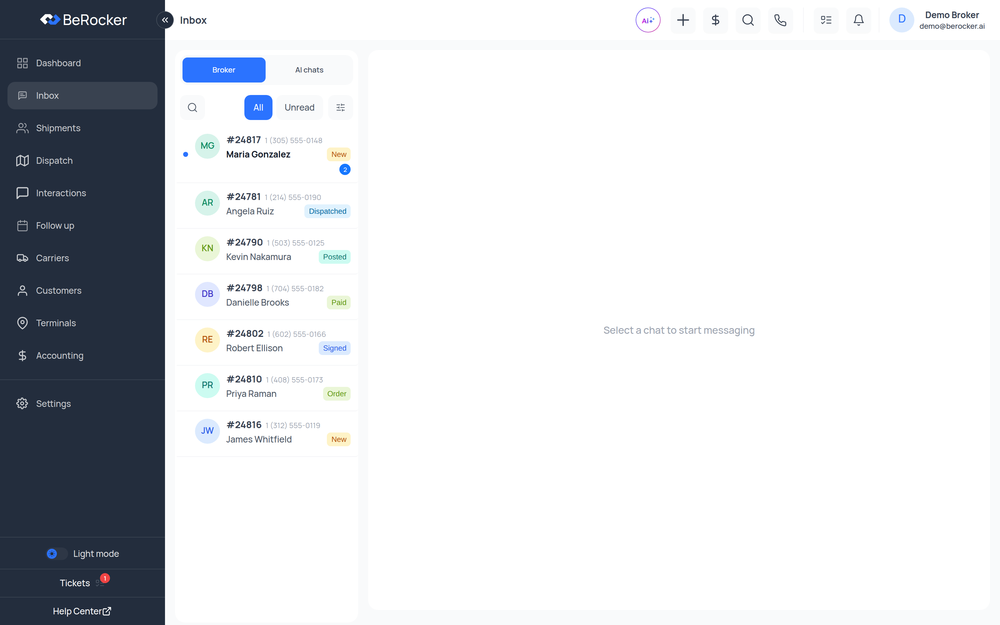
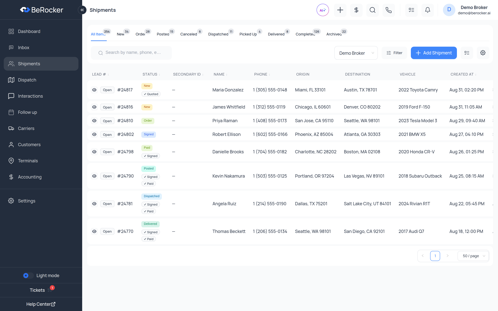
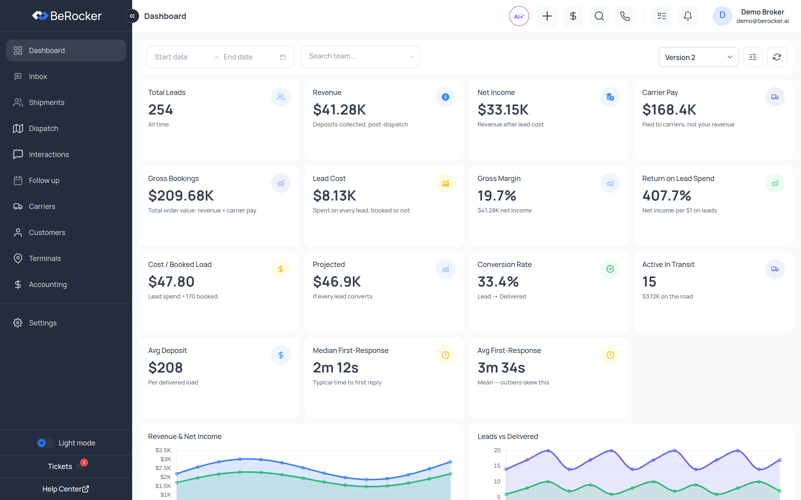
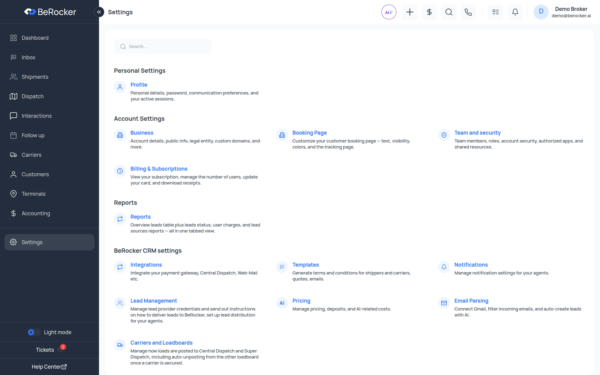

Five minutes here will save you a lot of clicking. Every screenshot on this page is the real CRM.

---

## The sidebar

Everything in BeRocker hangs off the left sidebar. The things you touch every hour are at the top,
your directories in the middle, and settings and help at the bottom. Items you do not have
permission for are not shown.

| Item | What it is |
| --- | --- |
| **Get started** | The setup checklist, with a badge counting the steps left. Shown while your company is still setting up, or when an admin turned it on in Settings. |
| **Dashboard** | Your numbers at a glance: leads, revenue, margin, conversion, response times. |
| **Inbox** | Texts, emails and calls with customers. |
| **Shipments** | Every quote and order, by stage. |
| **Dispatch** | Loads to post, carrier offers and loads on the road. |
| **Interactions** | Calls and texts from numbers the CRM does not recognise yet. |
| **Follow up** | Who to call or answer next, and the follow-up calendar. |
| **Directories** | Opens to **Carriers** (haulers you dispatch to), **Customers** (people and companies who ship with you) and **Terminals** (dealers, auctions and ports). The CRM remembers whether you left it open. |
| **Accounting** | Payments, carrier pay and commissions. |
| **Marketing** | Cold email campaigns. Shown only when BeRocker has turned it on for your company and your role can see it. |
| **AI Team** | Set up, teach and test the Sales assistant. Shown only when it is turned on for your company and your role can see it. |
| **Settings** | Company, team and integrations. |

Below them are the **Light mode** / **Dark mode** switch and the **Help** button. The round arrow
button folds the sidebar to icons; hover an icon to see its name. With the sidebar folded,
hovering **Directories** shows Carriers, Customers and Terminals beside it.

<Tip>
  If a menu item is missing for you, it is your role, not a bug. Ask an admin. See
  [Team and security](/settings/team-and-security).
</Tip>

---

## The Help menu

Click **Help** at the bottom of the sidebar. A red badge on it counts unread replies from BeRocker
support. The menu holds:

| Item | What it does |
| --- | --- |
| **How-to videos** | Short videos on how things work. Shown when your company has how-to videos turned on. |
| **Help Center** | Step-by-step articles (this site), in a new browser tab. |
| **Support tickets** | Ask the BeRocker team. They reply within 24 hours. Shows your unread replies. |
| **What's New** | The latest changes to the CRM (**Settings → What's New**). |
| **Keyboard shortcuts** | Opens the list of keys (see below). |

---

## Keyboard shortcuts

**Help → Keyboard shortcuts** lists the keys that work in the CRM:

| Where | Key | What it does |
| --- | --- | --- |
| Everywhere | Ctrl+K (⌘K on a Mac) | Search shipments, customers and messages |
| Everywhere | Esc | Close the window that is open |
| Follow up call list | J, K (or ↓ ↑) | Next or previous row |
| Follow up call list | ? | All of the call list keys |
| Follow up calendar | T | Today |
| Follow up calendar | N, P (or J, K) | Next or previous period |
| Follow up calendar | D, W, M, A | Day, week, month or agenda |

The full list of work list keys is on [Follow up](/using/follow-up).

---

## The top bar

The page title is on the left. On the right, from left to right:

| Button | What it does |
| --- | --- |
| **Search shipments** | Global search, also opened with Ctrl+K (⌘K on a Mac). |
| **New shipment** | Opens **Add Shipment** from anywhere, the same form as **+ Add Shipment** on the Shipments screen. The arrow next to it offers **Quote a route**: price a route without saving it. If you can quote but not create shipments, the button is **Quote a route** instead. Shown only if you can do one of the two. |
| **Ask AI** | Opens the [AI Assistant](/using/ai-assistant). |
| **Calls** (phone) | The dialpad and your call history. |
| **Tasks** | Things assigned to you that need doing. Shown if your role can see tasks. |
| **Notifications** (bell) | See [Notifications](/settings/notifications) to choose which ones. |
| **Your name** | **View profile** and **Log out**. |

Warnings can appear next to the page title: a reminder to add your default contact details, a
**Register your number** button when a RingCentral number needs registering, and a **Reconnect**
warning when an integration needs to be connected again (click it to go to Integrations, or hide
it for today).

On a phone the top bar shrinks to two things: the round **AI Assistant** button and your avatar.
Tapping the avatar opens a drawer with **Add shipment**, **AI Assistant**, **How-to videos**,
**Quote a route**, **Global Search**, **Calls history**, **Tasks**, **Notifications**, the **Get
started** chip while setup is unfinished, and **Logout**.

---

## Inbox: where you talk to customers

<Frame>
  
</Frame>

- **Broker / AI chats** switches between conversations you are handling and the ones the AI is
  handling.
- **All / Unread** and the filter icon narrow the list.
- Open a conversation and you get the message thread in the middle and the lead panel on the right,
  with tabs for **Details**, **Booking** and **Carrier**.

Full page: [Inbox](/using/inbox)

---

## Shipments: every lead in one table

<Frame>
  
</Frame>

The tabs across the top are the pipeline: **All Items, New, Order, Posted, Dispatched,
Picked Up, Delivered, Completed, Canceled, Archived**, each with a live count. Inside **New**, **Order** and
**Posted** there is a second row of sub-filters (Not Quoted / Quoted, Needs Contract / Contract Sent
/ Signed / Paid, No Offers / Has Offers).

Full page: [Shipments](/using/shipments)

---

## Dashboard: the numbers

<Frame>
  
</Frame>

Every tile says what it measures underneath the number, so nobody has to guess whether "Revenue"
means deposits or gross bookings.

Full page: [Dashboard](/using/dashboard)

---

## Settings: one page per thing

<Frame>
  
</Frame>

Settings is grouped into **Personal Settings**, **Account Settings**, **Reports** and
**BeRocker CRM settings**. The search box at the top jumps straight to any settings page or tab:
type "quiet hours", "deposit", "2FA" and press Enter.

Full section: [Settings](/settings/profile)

---

## Next

<CardGroup cols={2}>
  <Card title="How a lead becomes a load" icon="route" href="/get-started/lead-journey">
    The pipeline explained status by status.
  </Card>
  <Card title="Setup checklist" icon="list-check" href="/get-started/setup-checklist">
    Everything to configure before you go live.
  </Card>
</CardGroup>
