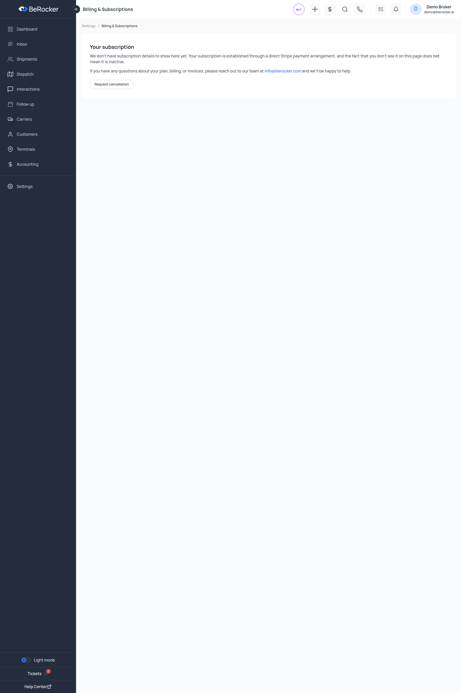

**Settings → Billing** shows *your plan, payment method and receipts*. Only people whose role can
view billing see it in the menu.

<Frame>
  
</Frame>

If you can see billing but cannot change it, the page says **Ask an administrator to make
changes.** and the buttons that change anything are hidden.

---

## What the Billing page shows

What you see depends on how your account is billed:

| Your account | What the page shows |
| --- | --- |
| **Billed in the app** | Three tabs: **Overview**, **Payments** and **Payment method**. |
| **Billed directly by the BeRocker team** | **Your plan** with an **Active** tag: *Your billing is handled directly by our team, so there's nothing to manage here.* Not seeing payment details does not mean anything is wrong. To change your plan or payment details, write to the support email shown. |
| **Part of a larger company** | **Billing is handled by your parent company.** There is nothing to do here. |
| **Billing not ready yet** | **We're still setting up your billing.** Your account keeps working as usual. |
| **Billing not available** | **Billing isn't available yet**, with the support email for questions. |

The support email is `info@berocker.com` unless your page shows a different one.

If the details shown are not the latest, the top of the page says *Showing details as of …* with a
**Refresh** link.

---

## Your plan (Overview tab)

The **Overview** tab has your plan card and your **Payment method** card.

The plan card shows the plan name, a status tag, the amount per billing period and what happens
next: *Next charge … on …*, *Renews on …*, or *Your plan ends on … You keep full access until
then.* It lists what the plan covers, any discount and any **Account credit**, and how many active
users you are billed for. People switched off in Team and security are not billed. It also says
where receipts are emailed.

| Status tag | Meaning |
| --- | --- |
| **Free trial** | You are in your free trial. |
| **Trial ended** | Your trial is over and no plan has started. |
| **Active** | Paid and current. |
| **Ending** | You cancelled; the plan ends at the end of the period. |
| **Payment due** | A payment failed. Update your card. |
| **Action needed** | Your bank needs you to confirm a payment. |
| **Add a card** | There is no payment method on file. |
| **Setup incomplete** | The subscription was not finished. |
| **Unpaid** | Payments have failed and money is outstanding. |
| **Paused** | Payments are paused. |
| **Canceled** | The plan has ended. |

When something needs your attention, a box at the top of the Overview tab says what and offers the
fix, such as **Update card**, **Add a card**, **Pay … now**, **Confirm payment** or **Subscribe**.
The same reminder can appear as a thin bar at the top of every page while a payment is overdue.

---

## Subscribe after your free trial

During a free trial, the plan card shows when the trial ends, what the plan will cost (**Base
license (includes 1 user)**, **Each additional user**, and an estimate for your current number of
users), and a **Subscribe** button.

1. Click **Subscribe**. The **Subscribe to BeRocker** dialog opens.
2. Enter your card details and confirm.

---

## Add or update your card

**Where:** **Settings → Billing → Payment method** tab, or the **Payment method** card on the
Overview tab.

1. Click **Update** (or **Add a card** if none is on file).
2. In the **Update payment method** dialog, enter **Name on card**, **Card number**, **Expiry**,
   **CVC** and **ZIP**.
3. Click **Save card**. If a payment is waiting, the button reads **Save card and pay …** and the
   new card is charged for it straight away.

The new card replaces the old one for all future payments. Card details are handled by Stripe;
BeRocker never stores them. The card shows its expiry date, and the card warns you when it has
expired or expires soon.

If you pay another way (for example by bank), the card shows that method and the button reads
**Use a card instead**.

---

## Download receipts (Payments tab)

The **Payments** tab lists every payment: **Date**, **Description**, **Amount** (with any refunded
or credited amount), **Status** and **Download PDF** for the receipt. Click **Load more** to see
older payments.

---

## Cancel your plan

**Where:** the **Cancel plan** link at the bottom of the **Overview** tab.

1. Click **Cancel plan**. The **Cancel your plan?** dialog opens.
2. It says you keep full access until the end of the current period, and nothing else will be
   charged.
3. Optionally pick a reason and add a note.
4. Click **Cancel on …** (the end date). Click **Keep plan** to back out.

Your plan's tag changes to **Ending** and the plan card shows the end date.

---

## Resume a cancelled plan

Before the end date, click **Resume plan** at the bottom of the **Overview** tab. Your plan
continues as before and nothing is interrupted. Once the plan has ended, it can no longer be
resumed from this page.

---

## Request a change when billing is handled by our team

If your billing is handled directly by the BeRocker team, click **Request a change or
cancellation**, describe what you want in the **Request a change** dialog and click **Send
request**. The team takes care of it and follows up by email, so nothing is interrupted by
accident.

---

## Related

<CardGroup cols={2}>
  <Card title="Team and security" icon="users" href="/settings/team-and-security">
    Billed users come from here.
  </Card>
  <Card title="Contact support" icon="life-ring" href="/support/contact">
    Anything billing-related a page cannot answer.
  </Card>
</CardGroup>
