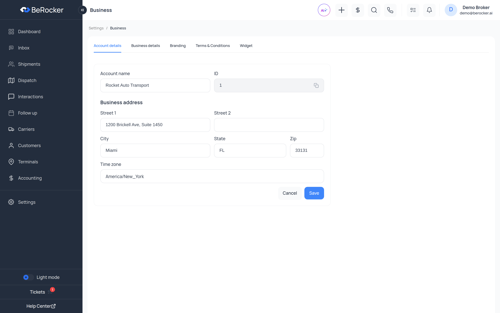
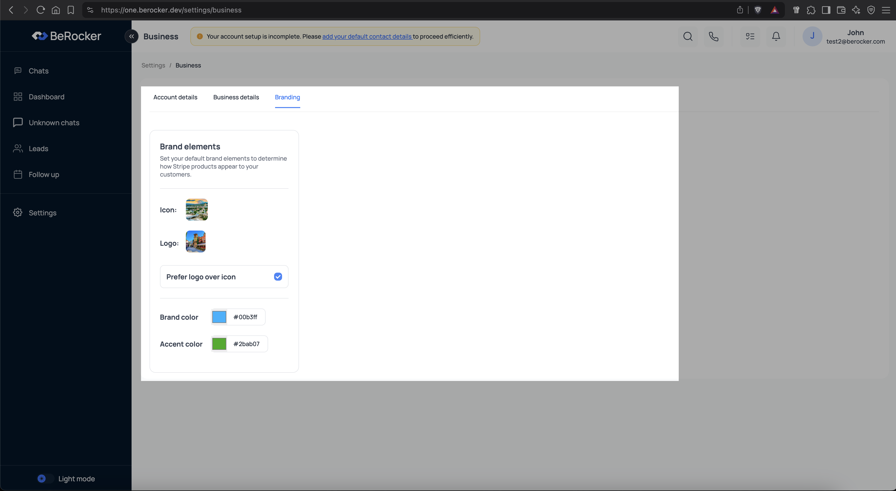

**Settings → Business** is your company as customers and carriers see it. Fill it in before you send
a single quote, because every one of these fields shows up on documents that go out under your name.

<Frame>
  
</Frame>

The tabs are **Account details**, **Business details**, **Branding**, **Terms & Conditions**,
**Widget** and **Hawaii shipping**. Each tab is shown only to people whose role allows it.

---

## Account details

| Field | Notes |
| --- | --- |
| **Account name** | Your business or brand name. |
| **ID** | Your organization ID: read-only, with a copy button. Support will ask for it. |
| **Business address** | Street 1, Street 2, City, State, Zip. |
| **Time zone** | The one your office works in. |

Click **Save** (or **Cancel**) under the form.

<Warning>
  Get the **time zone** right before you build any follow-up sequences. Quiet hours, scheduled
  messages and reminders are all worked out from it, so a wrong time zone means texts going out at
  the wrong hour.
</Warning>

---

## Business details

Two blocks, each with its own **Edit** button that turns into **Cancel** / **Save**.

**Business details**

- **URL**: your website.
- **Address**
- **Privacy Policy URL**: shown in the consent notice on the public quote widget; leave it
  empty and the widget omits the privacy-policy sentence.

**Public details**, under the heading *Customer support information*:

| Field | Where it shows up |
| --- | --- |
| **Business name** | Customer-facing documents and emails. |
| **Support address**, **Support phone**, **Support email** | Invoices, payment pages, message footers. |
| **Descriptor on customer statements** | What appears on the customer's card statement. |
| **Also provided** | A short description of what you do. |
| **M.C number** and **US DOT number** | Contracts and load board posts. |

<Tip>
  The **statement descriptor** is worth getting right. A charge that shows an unrecognisable name on
  a card statement is a chargeback waiting to happen.
</Tip>

---

## Branding

<Frame>
  
</Frame>

Under **Brand elements**:

- **Icon**: used in compact places. A square image works best.
- **Logo**: a PNG, used on documents and email templates.
- **Prefer logo over icon**: tick this if your logo already contains your business name.
- **Brand color** and **Accent color**: buttons and links in emails and on the booking page.

There is no Save button on this tab: each change is saved as soon as you make it.

---

## Terms & Conditions

One rich-text document: the terms that go out with your contracts. Edit the text in the editor
and click **Save**. *"Terms and Conditions saved successfully"* confirms it.

Message templates are a different thing and live in [Templates](/settings/templates).

---

## Widget

The quote form you put in front of customers. Three cards sit next to a live **Preview**
(**Desktop** / **Phone**):

- **Your quote form**: pick a **Style** (theme) and the **Lead source** the form posts to. Every
  setting on the tab is saved against that lead source, so each site or campaign can have its own
  form.
- **Put it in front of your customers**: three install routes: **Share a link** (a hosted page,
  nothing to install; copy the link), **Add to your site** (choose your site builder, follow the
  steps, **Copy the code**) or **Ask someone** (enter your web developer's email and click **Write
  the email**; it opens in your own mail program, nothing is sent from BeRocker).
- **After someone submits**: the switch **Send them straight to the booking page** sends
  visitors to your booking page as soon as their price is ready; off, they stay on the form and see
  a confirmation. Under the **Advanced** section for website conversion tracking, **Send conversion events to my
  website** lets the embedding page record a lead as a conversion, optionally restricted to the
  **Allowed website origins** you list (**Save origins**), with a **Copy the listener** snippet for
  GA4.

Leads from the widget arrive through the chosen [lead source](/settings/lead-sources) like any
other, so they get distributed, quoted and followed up the same way.

---

## Hawaii shipping

**Where:** **Settings → Business → Hawaii shipping**.

Cars reach Hawaii by ship, through a port. Turn on **Ship cars to and from Hawaii** and Hawaii
requests are handled that way everywhere, automatically. A tag beside the title shows **On** or
**Off**.

What turning it on does:

- **Your website form.** When a customer enters a Hawaii address, the form shows the island's port,
  already selected.
- **Your quotes.** A Hawaii request is priced as the mainland trip to the West Coast port plus your
  ocean freight.
- **Your booking page.** The customer sees the port, its address and its hours instead of being
  asked for a street address.

### Set the islands and ocean freight prices

Once Hawaii shipping is on, **Ports and ocean freight** lists each Hawaii port with its island and
address.

1. Untick any island you do not ship to. You must keep at least one; otherwise turn Hawaii shipping
   off.
2. Enter the ocean freight price for each port, in dollars **per vehicle**. It is added to the price
   of the mainland trip. The starting prices are estimates, so check them against your ocean
   carrier's rates.
3. Under **Deposit on Hawaii shipments**, set what you take per vehicle when the customer books:
   **One end at a port** and **Both ends at ports**. Leave a box empty to use the standard amount
   shown in it.
4. Click **Save changes**, or **Discard** to undo your edits.

If some islands have no price yet, a warning says quotes to those islands will leave the ocean leg
out. Click **Use starting prices** to fill them in.

On the mainland, cars go through the West Coast ports listed at the bottom of the tab. The closest
one is chosen from the customer's state, and the same ocean freight price applies whichever it is.

### Turn Hawaii shipping off

Switch **Ship cars to and from Hawaii** off and confirm **Turn off**. New Hawaii requests then come
in as ordinary door-to-door shipments, with no port and no ocean freight. Shipments you already have
keep their port, and your ports and prices are kept for when you turn it back on.

Only people whose role can change business settings can use this tab's switch and fields.

---

## Why this matters

Your business settings are used automatically in:

- Contracts and quotes sent to carriers and shippers
- Email templates, notifications and reminders
- Payment pages and card statements
- Your [booking page](/settings/booking-page)

Skipping it means documents go out with gaps in them.

---

## Related

<CardGroup cols={2}>
  <Card title="Booking page" icon="browser" href="/settings/booking-page">
    The page customers actually book on.
  </Card>
  <Card title="Templates" icon="message" href="/settings/templates">
    The messages that carry these details.
  </Card>
</CardGroup>
