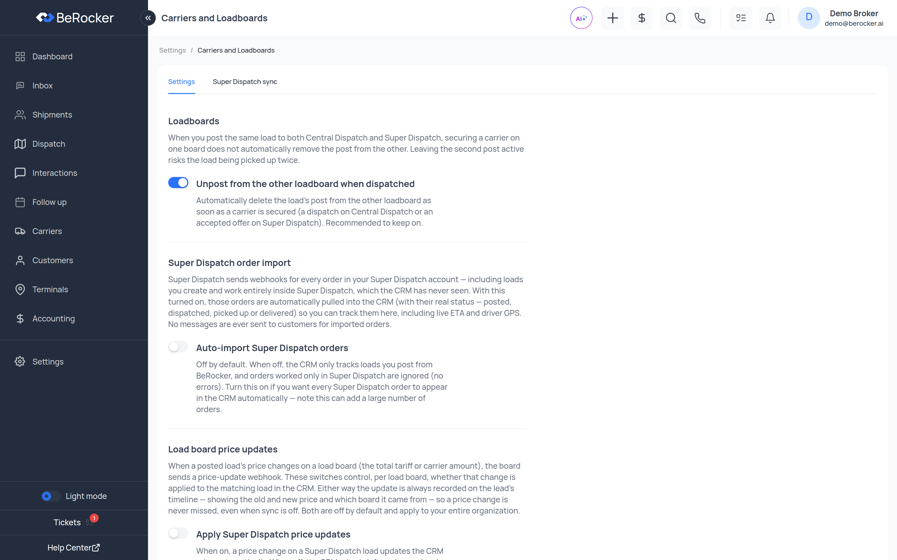

**Settings → Carriers and Loadboards** governs how BeRocker and your load boards keep each other
in step, and what insurance you require from carriers. Two tabs: **Settings** and **Super Dispatch
sync**.

<Frame>
  
</Frame>

Every switch on the Settings tab applies to your whole company. Each one is greyed out unless your
role allows changing it.

---

## Unpost from the other loadboard when dispatched

**Where:** **Settings tab → Loadboards**.

> When you post the same load to both Central Dispatch and Super Dispatch, securing a carrier on one
> board does not automatically remove the post from the other. Leaving the second post active risks
> the load being picked up twice.

With **Unpost from the other loadboard when dispatched** on, BeRocker automatically deletes the
load's post from the other board as soon as a carrier is secured: a dispatch on Central Dispatch,
or an accepted offer on Super Dispatch.

<Info>
  **Recommended to keep on.** The alternative is fielding calls about a load that is already
  covered, or two trucks showing up.
</Info>

---

## Import Super Dispatch orders automatically

**Where:** **Settings tab → Super Dispatch order import**.

Super Dispatch sends webhooks for every order in your Super Dispatch account, including loads you
create and work entirely inside Super Dispatch, which the CRM has never seen.

**Auto-import Super Dispatch orders** is off by default.

| Setting | What happens |
| --- | --- |
| **Off** | The CRM only tracks loads you post from BeRocker. Orders worked only in Super Dispatch are ignored, with no errors. |
| **On** | Every Super Dispatch order is pulled into the CRM with its real status (posted, dispatched, picked up or delivered), so you can track it here, including live ETA and driver GPS. |

<Warning>
  Turning it on can add a **large number** of orders, depending on how much you do outside the CRM.
  No messages are ever sent to customers for imported orders, but your Shipments table will grow.
</Warning>

Orders that could not be imported are listed on the **Super Dispatch sync** tab.

---

## Load board price updates

**Where:** **Settings tab → Load board price updates**.

> When a posted load's price changes on a load board (the total tariff or carrier amount), the board
> sends a price-update webhook. These switches control, per load board, whether that change is
> applied to the matching load in the CRM.

- **Apply Super Dispatch price updates**: when on, a price change on a Super Dispatch load updates
  the CRM price automatically.
- **Apply Central Dispatch price updates**: when on, a carrier price change on a Central Dispatch
  dispatch updates the CRM amount automatically.

Both are **off by default**. When off, the CRM price is left unchanged and the incoming change is
only noted on the timeline.

<Info>
  Either way, the update is **always recorded on the lead's timeline**, showing the old price, the
  new price and which board it came from. A price change is never missed, even when the switch is
  off.
</Info>

<Tip>
  Leave these off if the CRM price is your source of truth for invoicing, and use the timeline entry
  to decide case by case. Turn them on if you routinely renegotiate on the board.
</Tip>

---

## Set the minimum cargo coverage for carriers

**Where:** **Settings tab → Carrier insurance**.

Every carrier shows one line that says whether its insurance checks out, read from the certificate
Super Dispatch holds and from the FMCSA record. Set the cargo coverage you require and that line
flags any certificate below it.

1. Enter an amount in **Minimum cargo coverage** (in dollars; the arrows step by \$50,000).
2. Click **Save**. It is greyed out until you change the amount.

Leave the field empty (**No minimum**) to see each carrier's limit without judging it. Only people
whose role can edit carriers can change it.

---

## Super Dispatch sync

The **Super Dispatch sync** tab explains: *Orders created in Super Dispatch are pulled into the CRM
automatically as orders. Anything that couldn't be synced is kept here with the reason why.*

The table shows **Order #** (the lead number, with the Super Dispatch order number under it),
**SD status**, **Sync** (**Synced**, **Failed** or **Skipped**), **Details** (the reason),
**Synced** (when) and **Actions**. Use **Search by order # or status**, the **All statuses**
filter and **Refresh**. If nothing has come through yet, the tab says *No orders have synced from
Super Dispatch yet.*

---

## Retry or clear a failed Super Dispatch order

On the **Super Dispatch sync** tab, a **Failed** row has two buttons. Only people whose role can
change the Super Dispatch order import see them.

- **Retry** tries the import again straight away. The result says *Order … synced*, *Order already
  exists in the CRM* (nothing to do), or *The order still could not be synced* with the reason.
  If it still fails, open the order in Super Dispatch and check what is missing.
- **Clear** removes the row after you confirm: *Remove this order from the list? This only clears
  the entry; it doesn't affect the order in Super Dispatch.*

---

## Related

<CardGroup cols={2}>
  <Card title="Super Dispatch" icon="plug" href="/integrations/loadboards/superdispatch">
    Connecting the board.
  </Card>
  <Card title="Central Dispatch" icon="plug" href="/integrations/loadboards/centraldispatch">
    Connecting the board.
  </Card>
  <Card title="Dispatch" icon="map" href="/using/dispatch">
    Live GPS and ETA come from Super Dispatch.
  </Card>
  <Card title="Carriers" icon="truck" href="/using/carriers">
    Your carrier book.
  </Card>
</CardGroup>
