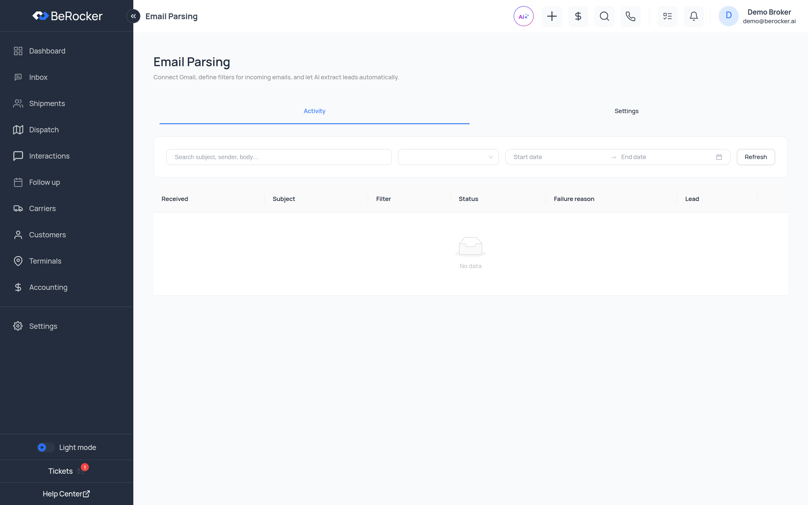

Some lead providers do not post leads to an endpoint; they email you. **Settings → Email Parsing**
connects a Gmail inbox, decides which emails are read, and has AI read them and create leads.

<Frame>
  
</Frame>

The screen has two tabs: **Activity** (every email that has been processed) and **Settings** (the
Gmail connection, how leads are created, the AI prompt and the filters).

If the feature is not available on your account yet, a banner at the top lists what is missing, and
connecting stays unavailable until it is resolved.

Until everything is in place, the Settings tab shows a **Finish setting up** checklist with
three steps: connect the Gmail inbox, choose which emails to read, and turn on **Process incoming
emails**. Each step is crossed off when it is done.

---

## Connect Gmail

On the **Settings** tab, the **Gmail inbox** card says *Connect the inbox your lead emails arrive
in. Read-only: nothing is ever sent or deleted.*

1. Click **Connect Gmail** and choose the mailbox that receives the lead emails.
2. Google may show *"Google hasn't verified this app"* first. That is expected and safe: click
   **Advanced**, then **Go to BeRocker (unsafe)**.
3. Keep **"View your email messages and settings"** checked and click **Continue**.

Open **What to expect when you connect** on the card for the same steps with a picture.

Once connected, the card shows a tag (**Connected**, **Needs reconnect**, **Error** or **Not
connected**), the linked address and when it was last checked.

- **Test** checks the connection still works.
- **Disconnect** stops turning emails into leads, after you confirm.
- If Google did not grant read access, the card says so and the button becomes **Reconnect
  Gmail**. Reconnect and keep "View your email messages and settings" checked.

BeRocker only reads incoming emails to create leads. It cannot send, change or delete anything in
the mailbox. You can disconnect at any time, here or in your Google Account under Security.

<Tip>
  Use a dedicated mailbox such as `leads@yourdomain.com` and forward provider emails to it. Pointing
  this at a personal inbox means the parser sifts through everything you receive.
</Tip>

---

## Turn automatic processing on or off

On the **Settings** tab, in the **How leads are created** card, **Process incoming emails** (*Turn
matching emails into leads automatically*) is the main switch. Leave it off while you set up your
filters and prompt, then turn it on.

---

## Read every email or only filtered emails

In the **How leads are created** card, **Read every email** decides which emails are read:

- **On**: *This inbox is only for leads: every email is read, filters are optional.* Use this for a
  mailbox that only receives lead emails.
- **Off**: *only emails that match an enabled filter below are read.*

An email that is not read is recorded on the Activity tab as **filtered out** and nothing is
created.

---

## Choose the status for new parsed leads

In the **How leads are created** card, **Create leads as** decides what a parsed email becomes:

- **New**: a regular New lead that goes through your normal quoting flow, just like any other
  incoming inquiry.
- **Order**: treated as an already-booked shipment. The lead is placed in the Order stage, the chat
  is handed to a broker and automated outreach is turned off.

---

## Detect the lead source

In the **How leads are created** card, **Detect the lead source** files each lead under the lead
website or marketplace that sent it, when its filter names no source. When it is off, those leads
go under *Email Parsing*.

A filter's own **Lead source** always wins over detection (see below).

---

## Set up filters

The **Filters** card lists your filters with **Filter** (name and a summary of its rules), **Lead
source** and an **On** switch, plus **Edit** and **Delete** (after you confirm *Delete this
filter?*). With no filters, the card tells you to add one or to switch on **Read every email**.

To add one, click **Add filter**. The **New filter** dialog has:

| Field | What it does |
| --- | --- |
| **Name** | For you, for example *New leads from main forwarder*. |
| **Match** | **All rules must match** or **Any rule can match**. |
| **Rules** | One or more conditions. **Add rule** adds another. |
| **Lead source** | **Automatic**, an existing lead source, or type a name and choose *Add "…" as a new source* to create one on save. |
| **Enabled** | Turn the filter off without deleting it. |

Each rule is a field, an operator and a value:

| Field | Operators |
| --- | --- |
| **From**, **To**, **Subject**, **Body** | Contains, Does not contain, Equals, Not equals, Matches regex |
| **Has attachment** | Is true, Is false (no value needed) |

How **Lead source** works: when you pick a source, every lead from an email matching this filter is
filed under it. On **Automatic**, the lead goes under the provider recognised in the email when
**Detect the lead source** is on, or under *Email Parsing* otherwise.

Click **Create** (or **Save** when editing).

### A filter that works

Start narrow:

- **From** contains `@leadprovider.com`
- **AND Subject** contains `New Lead`

then widen only if you find real leads being missed.

---

## Edit the AI prompt

The **AI prompt** card shows the version in use (for example *v3*), when it was updated and a
plain-words summary of what it does. **Show the full prompt** expands the text. With no prompt of
your own, the card says **Using the built-in prompt**: it is tuned for load tenders, and if your
leads come from lead websites or marketplaces you can start from the **Universal lead provider**
template.

Click **Edit** to open the **Email parsing prompt** editor. Its tabs:

- **Edit**: the prompt text with a character count and *Unsaved changes* or *Up to date with the
  current version*.
  - **Start from a template** loads a ready-made prompt, such as **Universal lead provider**
    (*Reads quote requests from any lead website or marketplace, customer emails, forwarded leads
    and multi-car load tenders, and recognises which lead provider sent them*). It replaces the
    text in the editor; nothing is saved until you save.
  - **What did you change? (optional)**: a short note for the change summary.
  - **Revert to current** throws away your edits. **Test this draft** opens the Test tab.
    **Save new version** saves it.
- **Test**: paste an email (**From**, **Subject** and the body), choose **Use the draft** or **Use
  the saved prompt**, and click **Run test**. You see whether it is a *Shipment request*, a *Reply
  about an existing shipment* or *Not a lead*, how many leads it would create and under which
  source, whether a filter would let it through, and each lead marked **Will be created** or
  **Will be skipped** with the reasons. Nothing is saved and no lead is created.
- **Summary**: a plain-language overview of the prompt. **Generate summary for current draft**
  writes a fresh one.
- **Version history**: every saved version with its date, who saved it, **What changed (AI)** and
  your **Editor note**. **Load into editor** copies an old version into the editor; **Restore**
  makes it the current prompt again. A change that makes parsing worse can always be undone.

You can also click **Test** on the AI prompt card to go straight to the Test tab.

<Warning>
  Change the prompt in small steps, test it, and watch the **Activity** tab afterwards. A prompt
  that reads well can still extract the wrong ZIP code.
</Warning>

---

## Check what happened to an email (Activity tab)

The **Activity** tab lists every email the parser has seen: **Received** (with the sender),
**Subject**, **Filter**, **Status**, **Failure reason**, **Lead**, **Lead source** and an
attachment count.

Use **Search subject, sender, body…**, the **Status** filter (Received, Processing, Parsed, Lead
created, Failed, Reply / inquiry, Not a lead), a date range, and **Refresh**.

| Status | Meaning |
| --- | --- |
| **received** | Arrived, not processed yet. |
| **processing** | Being read now. |
| **parsed** | Data extracted. |
| **lead created** | A shipment was created. The **Lead** column links to it. |
| **filtered out** | Not read: no enabled filter matched and **Read every email** is off. |
| **skipped duplicate** | The same lead already exists. |
| **Reply / inquiry** | A reply or inquiry, not a new lead. |
| **Not a lead** | Not a shipment request. |
| **failed** | Something went wrong; **Failure reason** says what. |

Click a row to open the details: **From**, **To**, whether it was **Forwarded** or a **Reply**, an
**Email preview** (**Cleaned content (sent to AI)** and **Original email**), **Attachments** with
**Download**, the **Filter match**, an **AI parsing** section (**Prompt used**, **Parsed JSON**,
**OpenAI response**) and a **Lifecycle** log. **Open lead #…** jumps to the created lead.

**Retry an email:** for a **failed** or **filtered out** email, click **Retry** in the details. For
a filtered-out email only the headers were stored, so adjust your filters first; Retry fetches the
body again and processes it.

---

## Troubleshooting

| Symptom | Check |
| --- | --- |
| Nothing is processed | Is **Process incoming emails** on? Is Gmail still connected? Click **Test**. |
| Everything is **filtered out** | Switch on **Read every email** for a leads-only inbox, or loosen your filters. Open one and read the real sender and subject. |
| Leads are created with wrong fields | Look at the **Parsed JSON** on that row, then adjust the prompt and use the **Test** tab. |
| Leads land under *Email Parsing* | Pick a **Lead source** on the filter, or turn on **Detect the lead source**. |
| Real leads marked **Reply / inquiry** or **Not a lead** | Paste one into the **Test** tab to see why, then adjust the prompt. |
| **Needs reconnect** | Google did not grant read access, or it was revoked. Click **Reconnect Gmail** and keep "View your email messages and settings" checked. |

---

## Related

<CardGroup cols={2}>
  <Card title="Lead sources" icon="filter" href="/settings/lead-sources">
    The API way of receiving leads.
  </Card>
  <Card title="Profile" icon="user" href="/settings/profile">
    Your personal Gmail connection.
  </Card>
  <Card title="Notifications" icon="bell" href="/settings/notifications">
    Alerts for parse successes and failures.
  </Card>
  <Card title="Shipments" icon="table" href="/using/shipments">
    Where the created leads land.
  </Card>
</CardGroup>
