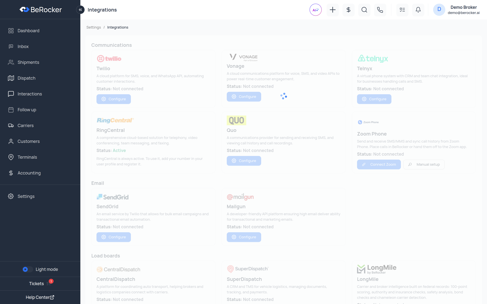
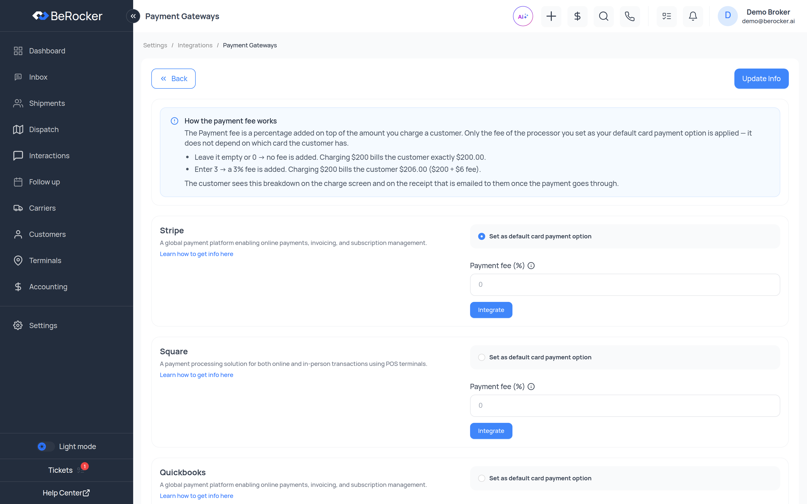

**Settings → Integrations** is where BeRocker plugs into the outside world. Nothing goes out (no
text, no email, no load board post) until something here is connected.

<Frame>
  
</Frame>

The page is grouped into **Communications**, **Email**, **Load boards**, **Marketing** (only when
your account has Marketing and your role manages its settings), **Accounting** (only when QuickBooks
is turned on for your account) and **Other**. You see only the cards your role allows.

Every card shows the provider, a one-line description, its **Status** (**Active**, **Disabled**
or **Not connected**) and its buttons. Most cards have **Configure**; the exceptions are listed
with each group below.

<Info>
  You only need the services you actually use. For a working CRM you need at least **one
  communication provider** and **one email provider**.
</Info>

---

## Communications

| Provider | What it does |
| --- | --- |
| **Twilio** | A cloud platform for SMS, voice and WhatsApp API, automating customer interactions. |
| **Vonage** | A cloud communications platform for voice, SMS and video APIs. |
| **Telnyx** | A virtual phone system with CRM and team chat integration, for businesses handling calls and SMS. |
| **RingCentral** | Cloud telephony, video conferencing, team messaging and faxing. |
| **Quo** | Sending and receiving SMS, plus call history and call recordings. |
| **Zoom Phone** | Send and receive SMS/MMS and sync call history from Zoom Phone. Place calls in BeRocker or hand them off to the Zoom app. |
| **Dialpad** | Calls, recordings, transcripts and SMS/MMS from Dialpad land on the right lead automatically. Click-to-call opens in the Dialpad app. |

Card buttons that differ from **Configure**:

- **Vonage**: **Configure**, and once connected **Test Connection**, **Test SMS** and **Test Call**. See [Vonage](/integrations/phone/vonage-add-user).
- **Zoom Phone**: **Connect Zoom** and **Manual setup** until connected; then **Configure** and **Disconnect**.
- **Dialpad**: **Connect** (or **Configure** once connected, or **Paste new key** when its status reads **Needs a new API key**), **Test connection** and **Disconnect**.

<Warning>
  **RingCentral is always shown as Active.** The card says *"RingCentral is always active. To use
  it, add your number in your user profile and register it."* There is nothing to configure on this
  page. Add your RingCentral number in **Settings → Profile → User Contacts** and click
  **Register** next to it. See [Profile](/settings/profile).
</Warning>

Setup guides: [Twilio](/integrations/phone/how-to-configure-twilio) ·
[RingCentral](/integrations/phone/add-ring-central-phone-numbers) ·
[Telnyx](/integrations/phone/telnyx/telnyx-setup) ·
[Vonage](/integrations/phone/vonage-add-user) ·
[Zoom Phone](/integrations/phone/zoom-phone)

---

## Connect Dialpad

**Where:** **Settings → Integrations → Communications → Dialpad**.

1. A Dialpad **Company Admin** creates an API key in Dialpad: **Admin Settings → My Company →
   Authentication → API Keys → Add Key**. API keys need a Dialpad **Pro or Enterprise** plan.
2. When creating the key, select these additional scopes: **recordings_export** (call recordings
   and voicemails reach the CRM), **message_content_export** (company-wide; the text of incoming
   messages reaches the CRM) and **calls:list** if offered (hourly recovery of anything a webhook
   missed).
3. On the Dialpad card, click **Connect**. In **Dialpad settings**, paste the **API key**,
   optionally set **Key expires on (optional)**, set **Status**, and click **Connect Dialpad**.

The key is checked with Dialpad before it is saved, and calls, texts, recordings and transcripts
start syncing automatically. The webhook is registered in Dialpad for you and checked every hour;
there is nothing to copy into Dialpad.

**Test connection** opens **Dialpad connection**: what works, the API key and its expiry, the
webhooks and the last event received. Under **Try it**, if you have your own Dialpad number in your
Profile contacts, type a number and click **Send test SMS** or **Ring from my Dialpad app**.

**Disconnect** stops calls and texts syncing and removes the webhook from Dialpad. The key is kept
so you can reconnect in one click.

When the key expires or is revoked, the status reads **Needs a new API key**. Click **Paste new
key** and save a new one.

---

## Email

| Provider | What it does |
| --- | --- |
| **SendGrid** | An email service by Twilio for bulk campaigns and transactional email automation. |
| **Gmail** | Send and receive chat emails through each team member's own Gmail or Google Workspace mailbox. |
| **Mailgun** | A developer-friendly API platform for transactional and marketing email deliverability. |

Setup guides: [SendGrid](/integrations/email/sendgrid/sendgrid-setup) ·
[Mailgun](/integrations/email/mailgun/how-to-configure-mailgun-in-berocker-settings) ·
[Gmail](/integrations/email/gmail)

<Tip>
  Before you send a single campaign, read
  [Email deliverability](/integrations/email/sendgrid/email-deliveribility). Getting SPF, DKIM and
  DMARC right is the difference between the inbox and the spam folder.
</Tip>

---

## Load boards

| Provider | What it does |
| --- | --- |
| **CentralDispatch** | Coordinating auto transport, helping brokers and logistics companies connect with carriers. |
| **SuperDispatch** | A CRM and TMS for vehicle logistics, managing documents, tracking and payments. |
| **LongMile** | Carrier and broker intelligence built on federal records: 100-point scoring, authority and insurance checks, safety analysis, bond checks and chameleon carrier detection. |

Card buttons that differ from **Configure**:

- **CentralDispatch**: **Integrate** until connected; then **Test Connection** and **Disconnect**; **Reconnect** and **Disconnect** when the connection has expired.
- **SuperDispatch**: **Configure**, and once connected **Test Connection** and **Webhook Status**.
- **LongMile**: **Connect LongMile** (or **Reconnect LongMile**) and **Disconnect**.

Setup guides: [Central Dispatch](/integrations/loadboards/centraldispatch) ·
[Super Dispatch](/integrations/loadboards/superdispatch) ·
[LongMile](/integrations/loadboards/longmile)

Posting behaviour (auto-unposting, order import and price updates) is configured separately in
[Carriers and Loadboards](/settings/carriers-and-loadboards).

---

## Marketing

Shown only when your account has Marketing and your role manages Marketing settings. Each card has
**Connect** (or **Manage** once connected).

| Provider | What it does |
| --- | --- |
| **Instantly** | Send cold email through your Instantly account: mailbox rotation, warm-up and reply detection handled for you. |
| **Smartlead** | Send cold email through your Smartlead account: unlimited mailboxes, warm-up and a shared inbox. |
| **Vercel** | Buy sending domains and have their DNS records written for you, so cold email never touches your main domain. |
| **Cloudflare** | For domains whose DNS is on Cloudflare: we write the email records for you. |
| **Porkbun** | For domains registered at Porkbun: we write the email records for you. |

---

## Accounting

| Provider | What it does |
| --- | --- |
| **QuickBooks** | Sends booked orders, payments and refunds to QuickBooks Online automatically, as invoices, payments and refund receipts. |

The card shows a **Status** (**Not connected**, **Connected, finish setup**, **Sending orders**, **Paused**,
**Reconnect needed** or **Turned off**) and **Connect**, **Finish setup** or **Configure**, and
**Disconnect** buttons. **Disconnect** asks you to confirm: nothing more will be sent, and what is
already in QuickBooks stays there. The card appears once QuickBooks is turned on for your account;
contact BeRocker support if you do not see it.

Setup guide: [QuickBooks](/integrations/accounting/quickbooks)

---

## Payment Gateway

Under **Other**. The card also shows the **Connected CC Gateway** and whether you **Accept Zelle**.

> Expand your business by accepting payments from customers! You can connect any of the following
> payment gateways: Stripe, Square and Zelle

**Configure** opens **Settings → Integrations → Payment Gateways**, where you connect the
processors. Each card has a **Set as default card payment option** radio and a **Payment fee
(%)** field. The fee is a percentage added on top of what you charge, and only the default
processor's fee is applied.

<Frame>
  
</Frame>

| Card (in page order) | Type |
| --- | --- |
| [Stripe](/integrations/payment/stripe) | Charges the card |
| [Square](/integrations/payment/square) | Charges the card |
| [RevitPay](/integrations/payment/revitpay) | Charges the card (Username, Password, Source Key) |
| [AuthorizeNet](/integrations/payment/authorize-net) | Charges the card |
| [Zelle](/integrations/payment/zelle) | Record-only bank transfer (**Zelle Email** and **Zelle Number**) |

<Info>
  Only **Stripe**, **Square** and **Authorize.Net** can tell whether a saved card is credit, debit or
  prepaid. If you pass card processing fees on to customers and waive them for debit, your default
  processor has to be one of those three. See [Accounting](/using/accounting).
</Info>

---

## Reconnecting

Connections expire or get revoked. When Central Dispatch's does, its card says its token could no
longer be refreshed, so messages and payments are paused, and shows a **Reconnect** button.
LongMile's button turns into **Reconnect LongMile**, QuickBooks shows **Reconnect**, and Dialpad
shows **Paste new key**. Reconnect rather than ignoring it: a disconnected load board silently stops
posting.

---

## FAQ

<AccordionGroup>
  <Accordion title="What happens if I skip integrations?">
    The CRM cannot send messages, place calls or post to load boards. Integrations are not optional
    extras; they are what makes the CRM do anything.
  </Accordion>
  <Accordion title="Can I change providers later?">
    Yes. Disconnect and connect a different one from this page at any time. Remember to update your
    team's **User Contacts** to point at the new provider.
  </Accordion>
  <Accordion title="How do I know it worked?">
    The card shows **Status: Active** in green (**Disabled** or **Not connected** otherwise).
  </Accordion>
  <Accordion title="Can I use two providers at once?">
    Yes. RingCentral for calls and Twilio for SMS is a common setup. Each user contact picks its own
    provider.
  </Accordion>
</AccordionGroup>

---

## Related

<CardGroup cols={2}>
  <Card title="Profile" icon="user" href="/settings/profile">
    Point your own number at a connected provider.
  </Card>
  <Card title="Carriers and Loadboards" icon="truck" href="/settings/carriers-and-loadboards">
    How posting behaves once the boards are connected.
  </Card>
  <Card title="MCP connection" icon="plug" href="/integrations/mcp/mcp-connection">
    Use BeRocker from Claude.
  </Card>
  <Card title="Email parsing" icon="envelope" href="/settings/email-parsing">
    Turn provider emails into leads.
  </Card>
</CardGroup>
