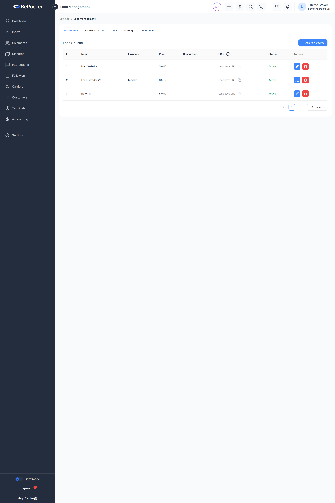
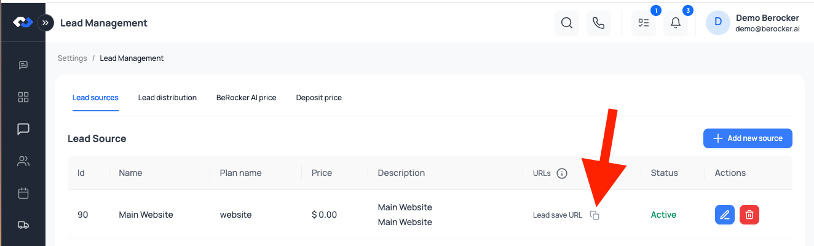

A **lead source** is one place leads come from: your website, a paid provider, a referral programme.
Creating one gives you a unique endpoint URL to hand to that provider, and lets BeRocker attribute
leads and cost correctly.

Lead sources live on the **Lead sources** tab of **Settings → Lead Management**. The other tabs on
that screen are described in [Lead management](/settings/lead-management).

<Frame>
  
</Frame>

---

## The lead sources list

The table lists **Id**, **Name**, **Plan name**, **Cost**, **Leads**, **Provider contact**,
**Description**, **Urls**, **Status** and **Actions**.

- **Cost** shows either a price *per lead* or a percentage *of collected payments*, depending on
  the source's lead cost model.
- **Leads** shows the total, how many arrived in the last 30 days and the date of the last one,
  or *No leads yet*.
- **Provider contact** shows the contact's name and email, and either *Instructions sent* with a
  date or *Instructions not sent yet*.
- **Urls** holds the **Lead save URL** with a copy icon. That URL is what receives leads.
- **Actions** has an envelope button (email the API link and instructions to the provider), an
  edit button and a delete button. You see only the buttons your role allows.

---

## Add a lead provider and email them the instructions

Use **Add lead provider** when a paid provider will send you leads. It creates the source and
emails the provider its API link and instructions in one go. Only people whose role can add lead
sources see this button.

<Steps>
  <Step title="Click Add lead provider">
    On the **Lead sources** tab. The **Add lead provider** dialog opens.
  </Step>
  <Step title="Say who the provider is">
    - **Lead provider name** (required), for example *Quote Wizard*.
    - **Contact name**: who to address the email to.
    - **Contact email** (required): where the instructions go.
    - **Per lead price ($, optional)**. You can change the cost model, branding and other details
      later from the source's edit button.

    Click **Create & draft email**. The lead source is created now.
  </Step>
  <Step title="Review the email">
    The dialog changes to **Review the email to the lead provider**. A note confirms the lead
    source is ready, with a **Copy URL** link for its lead save URL. Check **To (name)**, **To
    (email)** and **Subject**. The email preview is exactly what the provider will receive. It is
    sent from the BeRocker notification sender, with your email address as the reply-to.

    To change the wording, click **Edit email**, make your changes and click **Done editing**.
  </Step>
  <Step title="Send it">
    Click **Send email**. The dialog shows **Instructions sent**: *The lead provider has your API
    instructions.* A copy goes to your inbox and the provider's reply reaches you directly. Click
    **Done**.

    If you do not want to send it yet, click **Skip for now**. The source stays created and you
    can send the instructions later.
  </Step>
</Steps>

---

## Send or resend the instructions for an existing source

On the **Lead sources** tab, click the envelope button on the source's row (*Email the API link
and instructions to the lead provider*). The **Review the email to the lead provider** dialog
opens straight away, filled with the source's provider contact. Check the recipient, edit the
email if you need to, and click **Send email**.

The **Provider contact** column then shows *Instructions sent* with the date.

---

## Add a lead source yourself

Use **Add new source** for your own website or any source you connect yourself.

<Steps>
  <Step title="Click Add new source">
    On the **Lead sources** tab. The **Add new source** dialog opens.
  </Step>
  <Step title="Fill it in">
    | Field | Required | Notes |
    | --- | --- | --- |
    | **Lead source name** | Yes | For example `Main Website`. |
    | **Plan name** | No | If your provider sells by plan. |
    | **Lead cost model** | No | **Fixed price per lead** or **% split of collected payments** (see below). |
    | **Per Lead Price ($)** or **Source share (%)** | Depends | Shown according to the cost model. |
    | **Organization name** | No | The official DBA name for this source. When set, it is used in templates, SMS and email sent to leads from this source instead of the Business name. |
    | **Website** | No | When set, it takes priority over the Business website in templates for leads from this source. |
    | **Provider contact name**, **Provider contact email** | No | Where the API link and instructions are emailed from the envelope button. |
    | **Logo (optional)** | No | **Upload Logo** (PNG). When set, it is used in templates sent to leads from this source; otherwise your Business branding logo is used. |
    | **Description** | No | Anything your team should know. |
  </Step>
  <Step title="Apply, then copy the endpoint URL">
    Click **Apply**. Copy the **Lead save URL** from the **Urls** column and give it to the
    provider, or point your own website form at it.
  </Step>
</Steps>

<Frame>
  
</Frame>

<Info>
  Each source has its own unique URL, so authentication is built in. There is no separate API key
  to send.
</Info>

<Warning>
  Treat the endpoint URL like a password. Anyone who has it can create leads in your account.
</Warning>

The exact payload format is documented in [Lead source API](/integrations/lead-source-api), and
[Build your own quote form](/integrations/custom-quote-form) walks through a form of your own that
saves the lead, waits for the automatic quote and hands the customer straight to the booking page.

---

## Edit or delete a lead source

- **Edit:** click the edit button on the source's row. The **Update source** dialog has the same
  fields as **Add new source**, plus **Status**. Click **Apply**.
- **Delete:** click the delete button and confirm *Are you sure delete this source?*.

Use **Inactive** while you are between contracts rather than deleting the source. Deleting loses
the history behind your reports.

---

## Choose the lead cost model

Every source has a **Lead cost model**, set in the **Add new source** or **Update source** dialog:

| Lead cost model | What you enter | How cost is counted |
| --- | --- | --- |
| **Fixed price per lead** | **Per Lead Price ($)** | A fixed cost recorded on every lead this source sends. |
| **% split of collected payments** | **Source share (%)**, from 0 to 100 | This source earns this percentage of every payment collected on a lead it sent, with refunds deducted. Its leads cost nothing until a customer pays; then the lead cost and ROI in reports follow the money. |

The lead cost feeds every cost figure in the product:

- **Lead Cost** and **Return on Lead Spend** on the [Dashboard](/using/dashboard)
- **Cost / Booked Load**
- The **Lead Sources** [report](/settings/reports): total charges, average charge and ROI

Leave a fixed price at 0 for free sources like your own website.

---

## Lead source status

The **Status** field appears when you edit a source.

| Status | Effect |
| --- | --- |
| **Active** | Leads are accepted. |
| **Inactive** | Paused. |
| **Blocked** | Rejected. |

---

## Video walkthrough

<iframe
  src="https://scribehow.com/embed/Add_a_New_Lead_Source_in_Berocker_App__n8ftmf6BQb2imH8rqLcrJA?as=scrollable"
  width="100%"
  height="800"
  frameborder="0"
  allowfullscreen
></iframe>

---

## Related

<CardGroup cols={2}>
  <Card title="Lead management" icon="list-check" href="/settings/lead-management">
    Logs, lead numbering, deleting a lead and importing data.
  </Card>
  <Card title="Lead source API" icon="code" href="/integrations/lead-source-api">
    The payload format to POST.
  </Card>
  <Card title="Build your own quote form" icon="wand-magic-sparkles" href="/integrations/custom-quote-form">
    Your own form instead of the widget.
  </Card>
  <Card title="Lead distribution" icon="share-nodes" href="/settings/lead-distribution">
    Who gets these leads.
  </Card>
  <Card title="Email parsing" icon="envelope" href="/settings/email-parsing">
    For providers that email instead of POST.
  </Card>
  <Card title="Reports" icon="file-lines" href="/settings/reports">
    ROI per source.
  </Card>
</CardGroup>
