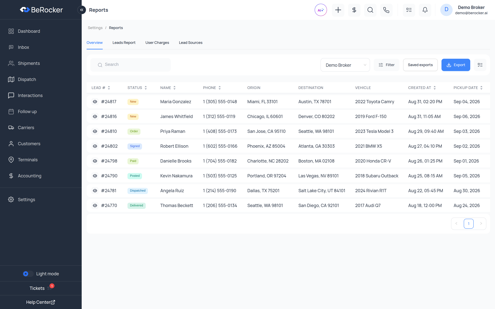

**Settings → Reports** is the export and analysis view. Four tabs:
**Overview**, **Leads Report**, **User Charges** and **Lead Sources**. **Leads Report**, **User Charges** and **Lead
Sources** are shown only to people whose role allows each report.

<Frame>
  
</Frame>

---

## Overview

The full leads table, built for exporting rather than working. Search, filter, pick an agent, choose
your columns, and export.

| Control | What it does |
| --- | --- |
| **Search** | Name, phone, email, lead number. |
| **Owner** | One agent, or everyone. |
| **Filter** | Status, dates, source, lanes, tags and more. |
| **Saved exports** | Your saved export configurations. |
| **Export** | Opens the **Export Report** dialog. |
| Columns button | Choose which columns appear, and therefore which ones export. |

### Saved export configurations

If you build the same export every month, save it:

<Steps>
  <Step title="Set it up">
    Filter and choose columns until the table shows exactly what you want.
  </Step>
  <Step title="Click Export">
    In the **Export Report** dialog, pick a **Scope** and give the **File name**.
  </Step>
  <Step title="Tick Save this export configuration">
    Give the **Configuration name** (e.g. *Weekly statements*) and click **Export**.
  </Step>
  <Step title="Next month">
    Open **Saved exports**. The **Saved export configurations** list shows each one with its number
    of columns and when it was last updated. Click one to apply its filters and columns, then
    export.
  </Step>
</Steps>

The **Scope** is **Current view** or **All matching**: the page you are looking at, or every row
your filter matches.

To remove a saved export, click the bin button next to it in **Saved export configurations** and
confirm *Delete this saved export?*.

---

## Leads Report

Leads broken down by status over the date range you pick. The quick answer to "how much is sitting in
each stage right now" and "how did last month compare".

---

## User Charges

What each agent earned over the date range you pick, using the pay settings on their user record,
grouped by team. **Filter by Teams** narrows it to some teams. The columns are:

**Total count · Total amount · Fixed amount · Shareholding fee · Percentage fee · Total**

Set the pay rules in
[Team and security → Set pay and commission](/settings/team-and-security).

---

## Lead Sources

Per-provider performance:

| Column | What it is |
| --- | --- |
| **Name** | The lead source. |
| **Leads** | How many arrived. |
| **Transactions** | How many turned into money. |
| **Total Charges** | What you spent on that source. |
| **AVG Charges** | Average cost per lead. |
| **ROI (%)** | Return on that spend. |
| **Actions** | Opens **Lead source details**: leads, responses, agree and disagree leads, signs, total and average costs, and transactions for that source. |

<Tip>
  This is the table to open before renewing a provider contract. A source with the most leads and
  the worst ROI is the one quietly costing you money.
</Tip>

---

## Reports vs Dashboard

| | Reports | [Dashboard](/using/dashboard) |
| --- | --- | --- |
| **Shape** | Tables you export | Tiles and charts |
| **Best for** | Payroll, accounting, provider reviews | Watching the business day to day |

---

## Related

<CardGroup cols={2}>
  <Card title="Dashboard" icon="chart-line" href="/using/dashboard">
    The same data as charts.
  </Card>
  <Card title="Accounting" icon="dollar-sign" href="/using/accounting">
    Transaction-level detail.
  </Card>
  <Card title="Lead sources" icon="filter" href="/settings/lead-sources">
    Where the cost figures come from.
  </Card>
  <Card title="Team and security" icon="users" href="/settings/team-and-security">
    Where payout rules are set.
  </Card>
</CardGroup>
