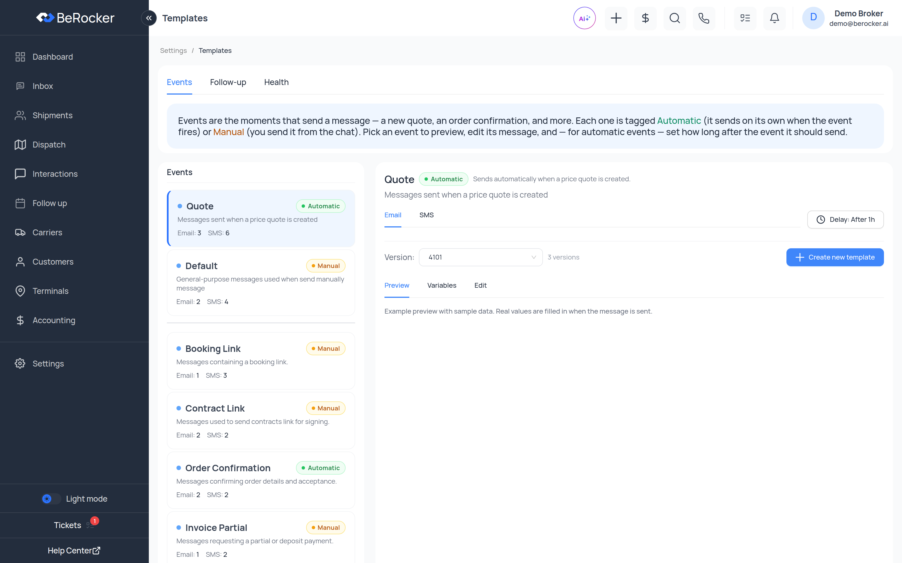
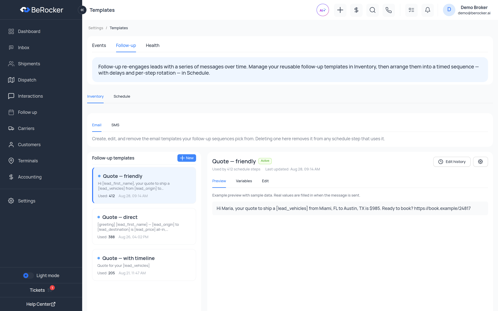

**Settings → Templates** is where every automated and semi-automated message lives. Three tabs:
**Events**, **Follow-up** and [**Health**](/settings/messaging-health).

<Frame>
  
</Frame>

---

## Events

> Events are the moments that send a message: a new quote, an order confirmation, and more. Each
> one is tagged **Automatic** (it sends on its own when the event fires) or **Manual** (you send it
> from the chat). Pick an event to preview, edit its message and, for automatic events, set how
> long after the event it should send.

The left column lists every event with its badge and how many **Email** and **SMS** templates it
holds. Pick one and the right side opens.

### The events

| Event | Sends | What it is for |
| --- | --- | --- |
| **Quote** | Automatic | Sent when a price quote is created. |
| **Default** | Manual | General-purpose messages you send by hand from the chat. |
| **Booking Link** | Manual | Messages containing a booking link. |
| **Contract Link** | Manual | Sending the contract for signing. |
| **Order Confirmation** | Automatic | Confirming order details and acceptance. |
| **Invoice Partial** | Manual | Requesting a deposit or partial payment. |
| **Invoice Full** | Manual | Requesting full payment or the final invoice. |
| **Dispatched** | Automatic | Sent when a carrier is dispatched. |
| **Driver Info** | Manual | Driver and carrier details. |
| **Picked Up** | Automatic | Sent when the load board reports pickup. |
| **Delivered** | Automatic | Sent when the load board reports delivery. |
| **Shipping Delayed** | Manual | Telling the customer about a delay. |
| **Delivered Follow Up** | Manual | Post-delivery follow-up. |
| **Reminder** | Automatic | Sent on schedule once reminders are on for the lead. |
| **Review Client** | Manual, or Automatic when you turn on the review request | Asking the customer for a review. See [Send a review request automatically after delivery](#send-a-review-request-automatically-after-delivery). |
| **Review Driver** | Manual | Asking the carrier for a review. |
| **Quote Reminder** | Manual, or Automatic when you turn on the shipping date reminder | A quote reminder sent when the shipping date is getting close. See [Remind customers before their shipping date](#remind-customers-before-their-shipping-date). |
| **Lead Reassigned** | Manual | Telling the customer their agent changed. |

Follow-up messages are not in this list; they have their own **Follow-up** tab.

<Info>
  An event is **Automatic** only when something in BeRocker sends it on its own. Everything else is
  Manual, because an agent can always send any template by hand from the chat.
</Info>

### Editing a template

Once you pick an event, the right side shows its **Automatic** / **Manual** badge and description,
then:

| Control | What it does |
| --- | --- |
| **Email / SMS** | Which channel you are editing. Each has its own templates. |
| Clock button → **Send delay** | Automatic events only (not Review Client, which has its own timing): how long after the event the message goes out, as **Days / Hours / Minutes**. Each channel has its own delay, and **Send delay by channel:** under the tabs sums it up. |
| Template dropdown | Which template you are looking at, with *"N templates"* beside it. Inactive ones are suffixed *(inactive)*. Under it: *Used by N schedules* and *Last updated*. |
| **Edit history** | Opens **Template history**: every saved version, viewable *With sample data* or *With variables*, with **Restore this version**. |
| **Create new template** | Adds another template for this event and channel. |
| Settings menu → **Delete this version** | Removes the selected template after you confirm. |
| **Preview** tab | The message rendered with sample data. |
| **Variables** tab | The raw template with its placeholders shown as-is. |
| **Edit** tab | The editor: **Name**, an **Active / Inactive** switch, **Subject** (email only), the variable pickers, the **Body**, and **Save changes**. Inactive templates are never used. |

### Template history

Every save creates a version. **Edit history** lets you look at any earlier one and restore it.
Useful when a change to a quote message coincides with a drop in replies.

Example follow-ups:

- *"Just checking in about your transport. Still interested?"*
- *"Quick follow-up on your quote. Want me to lock it in?"*
- *"Hi [lead_first_name], did you want to move forward with booking?"*

Follow-up messages are managed on the Follow-up tab: their templates live in its **Inventory**
and are placed on the sequence by hand in its **Schedule**.

---

## Send a review request automatically after delivery

**Where:** **Settings → Templates → Events → Review Client**.

Out of the box, the review request is Manual: an agent sends it from the chat. You can have
BeRocker send it on its own once a lead is delivered. A panel at the top of the Review Client event
reads *Auto-send when lead is **Delivered**, after* followed by a wait time.

1. Paste your review page address into the **Review link** field (for example your Google review
   link) and click **Save**. The open-link button next to it lets you check the link works.
2. Turn on the switch at the start of the panel. If no link is saved yet, the app asks you to paste
   your review link first.
3. Choose the wait time: **Right away**, **1 hour**, **3 hours**, **6 hours**, **12 hours**,
   **1 day (recommended)**, **2 days**, **3 days** or **1 week**. New setups start at 1 day so the
   request does not land on top of the delivered message.

What happens afterwards:

- The Review Client event's badge changes to **Automatic**.
- If your Review Client email or SMS template does not include the review link yet, BeRocker adds
  it for you and says so.
- Chips on the right show each channel's state: **SMS ✓** / **Email ✓** (will send with the link),
  **· no link**, **· off** or **· no template**. Click a chip to open that channel's template. If a
  template lost the link after you edited it, click **Add link** to put it back.

Rules (hover the info icon): it is sent once per order. It is not sent if the lead is no longer
Delivered by then, someone already asked for a review, or the customer opted out or replied. It
waits for quiet hours.

Only people whose role can change automatic messages can use the switch, the wait time and the
link. To stop it, turn the switch off.

---

## Variables

Variables are placeholders in square brackets that get filled in when the message is sent. On the
**Edit** tab, the pickers above the body list every variable available for that event with a
sample value, grouped by subject (General, Organization, Lead Source, Assistant, Lead, Vehicle,
Origin, Destination, Payment, Contract, Booking). Click one to insert it. The live list in the
app is always the authoritative one; the set differs per event.

The most-used ones:

<Columns cols={2}>
  <Card title="Customer">
    `[greeting]` · `[lead_first_name]` · `[lead_last_name]` · `[lead_full_name]` ·
    `[lead_phone]` · `[lead_email]`
  </Card>
  <Card title="The shipment">
    `[lead_id]` · `[lead_number]` · `[lead_vehicles_string]` · `[vehicle_count]` ·
    `[pickup_date]` · `[lead_drop_off_date]` · `[lead_delivery_days]` · `[lead_trailer_type]` ·
    `[lead_status]`
  </Card>
  <Card title="Money">
    `[lead_price]` · `[lead_open_price]` · `[lead_enclosed_price]` · `[lead_deposit]` ·
    `[balance_remaining]` · `[carrier_fee]` · `[quote_expires_at]` · `[refund_amount]` ·
    `[payment_amount]`
  </Card>
  <Card title="Links">
    `[lead_booking_link]` · `[lead_contract_link]` · `[review_link]` · `[lead_unsubscribe_link]`
  </Card>
  <Card title="Carrier and driver">
    `[carrier_name]` · `[carrier_phone]` · `[lead_driver_full_name]` · `[lead_driver_contact]`
  </Card>
  <Card title="Your company">
    `[organization_name]` · `[organization_phone]` · `[organization_email]` ·
    `[organization_website]` · `[organization_address]` · `[organization_logo]` ·
    `[organization_mc_number]` · `[organization_dot_number]`
  </Card>
  <Card title="The agent">
    `[assistant_name]` · `[assistant_display_name]` · `[assistant_phone]` · `[assistant_email]`
  </Card>
  <Card title="Origin and destination">
    `[origin_address]` · `[origin_city]` · `[origin_state]` · `[origin_zip]` ·
    `[origin_contact_name]` · `[origin_contact]` · `[destination_address]` ·
    `[destination_city]` · `[destination_state]` · `[destination_zip]` ·
    `[destination_contact_name]` · `[destination_contact]` · `[today_date]`
  </Card>
</Columns>

<Warning>
  Insert variables from the pickers rather than typing them. A misspelt variable renders as
  nothing, and the customer gets a message with a hole in it.
</Warning>

---

## Follow-up

<Frame>
  
</Frame>

> Follow-up re-engages leads with a series of messages over time. Manage your reusable follow-up
> templates in **Inventory**, then arrange them into a timed sequence, with delays and per-step
> rotation, in **Schedule**.

Two sub-tabs:

- **Inventory**: the **Follow-up templates** themselves. **New** creates one; each has the same
  **Preview / Variables / Edit** tabs, **Edit history** and **Delete template** as an event
  template.
- **Schedule**: the ladder of timed steps. **Follow-up for** picks a lead source: *pick a lead
  source to give it its own sequence, or edit the General one used by every source* (a source
  shows **General**, **Using General** or **Custom**). Steps start at **Sequence start**; the
  **+** button adds a step, and each step card is either **Send immediately** or **Send N days,
  N hours, N minutes after the lead enters**. Select a step, click **Select Templates** to put
  one or more inventory templates on it, then **Save**.

How the delays work, as the panel on the tab says: each step's delay is measured from when the
lead enters the sequence, **not** from the previous step, so give each step a larger delay than
the one before. Put **multiple templates on a single step** to rotate: one of them is picked at
random each time, so customers don't all get the same wording.

Leads from a paid provider often need a different cadence than leads from your own website,
and that is what the per-source sequence is for.

<Info>
  When you save a changed sequence, BeRocker tells you what it did to leads already part-way
  through: how many were in progress, how many moved to a different step, and how many stopped
  because the step they were waiting on no longer exists.
</Info>

### Building one that works

- **First step within the hour.** Response time is the single biggest lever on conversion.
- **Spread the rest out.** Something like 1 hour, 1 day, 3 days, 7 days.
- **One ask per message.** "Click to book" or "reply YES", never both.
- **Give SMS an opt-out.** The **Opt-out line** on the
  [Health](/settings/messaging-health) tab is added to the first automated text of a conversation,
  and again once a month.
- **Stop somewhere.** A sequence with no end is how numbers get flagged.

---

## Remind customers before their shipping date

**Where:** **Settings → Templates → Follow-up**, the panel above **Inventory** and **Schedule**.

The follow-up sequence is timed from the quote and is over within days. The shipping date reminder
is timed from the shipping date instead, so a customer quoted a month ahead still hears from you in
the week that matters. It is off until you turn it on.

1. Turn on the switch at the start of the panel: *Remind the customer about their quote*.
2. Choose how long *before the **shipping date***: 1, 2, 3, 5, 7, 10, 14, 21 or 30 days.

Turning it on creates its SMS and email message. Chips on the right show each one (**SMS ✓**,
**Email ✓**, **· off** or **· no message**); click a chip to open that message under
**Events → Quote Reminder** and reword it.

Rules (hover the info icon): it is sent once per lead, however long ago the quote was given. It goes
only to leads that are still New, have a price and a shipping date, and were created more than two
days ago. It is not sent if the customer opted out or the lead is blocked. It waits for quiet hours.

Only people whose role can change automatic messages can change it. Turn the switch off to stop it.

---

## Health

The third tab is [Messaging health](/settings/messaging-health): what your automated messaging is
actually doing right now: sending numbers, delivery rates, the queue, quiet hours and opt-outs.

---

## Troubleshooting

| Symptom | Check |
| --- | --- |
| Variables render empty | The exact spelling against the variable pickers on the **Edit** tab, and that the lead has that field filled in. |
| Message never sent | The template is **Active** (not suffixed *(inactive)* in the dropdown), and the event is the one you think it is. |
| Every customer gets identical follow-up text | Put more than one inventory template on that step of the Follow-up schedule; one is picked at random each time. |
| Automatic message did not fire | The event's badge. Is it actually **Automatic**? |
| Texts queued but not going out | [Messaging health](/settings/messaging-health): quiet hours, the per-minute pace, or a rested number. |

---

## Video walkthroughs

<Tabs>
  <Tab title="Standard">
    <iframe
      className="w-full aspect-video rounded-xl"
      src="https://www.youtube.com/embed/Mb5R5HLLzGo"
      title="Manage Templates in BeRocker"
      frameBorder="0"
      allow="accelerometer; autoplay; clipboard-write; encrypted-media; gyroscope; picture-in-picture"
      allowFullScreen
    ></iframe>
  </Tab>
  <Tab title="Enterprise">
    <iframe
      className="w-full aspect-video rounded-xl"
      src="https://www.youtube.com/embed/svwj98Ey_d8"
      title="Customize Templates, Enterprise Version"
      frameBorder="0"
      allow="accelerometer; autoplay; clipboard-write; encrypted-media; gyroscope; picture-in-picture"
      allowFullScreen
    ></iframe>
  </Tab>
</Tabs>

<Info>
  The videos show an earlier layout. The tabs were renamed to **Events**, **Follow-up** and
  **Health** in a later redesign. The concepts are unchanged.
</Info>

---

## Related

<CardGroup cols={2}>
  <Card title="Messaging health" icon="heart-pulse" href="/settings/messaging-health">
    Why a message has not gone out yet.
  </Card>
  <Card title="Follow up" icon="inbox" href="/using/follow-up">
    The human half of following up.
  </Card>
  <Card title="Business" icon="building" href="/settings/business">
    Where the company variables get their values.
  </Card>
  <Card title="Notifications" icon="bell" href="/settings/notifications">
    Internal alerts, not customer messages.
  </Card>
</CardGroup>
