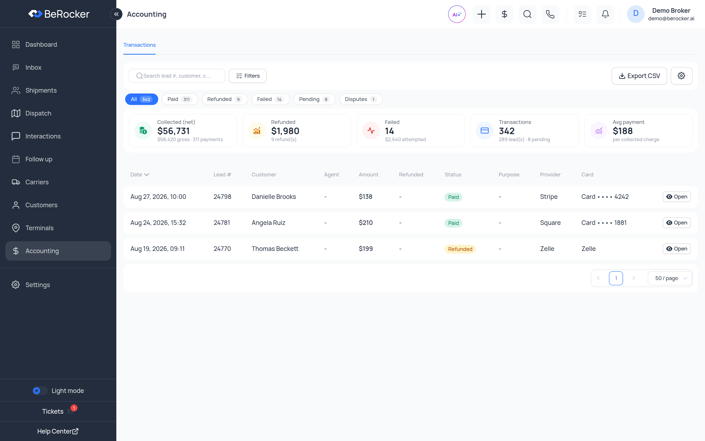

**Accounting** in the sidebar is the company-wide money view. It has four tabs: **Overview**,
**Transactions**, **Payables & Receivables** and **Commissions**.

You see **Accounting** in the sidebar only if your role is allowed to view accounting
transactions. Administrators and managers have it by default, and an administrator can give it to
other roles on the roles screen.

<Frame>
  
</Frame>

---

## Accounting overview: this week at a glance

**Accounting → Overview** is the tab that opens first. It shows four tiles. Click a tile to open the
tab it comes from.

| Tile | What it shows | Opens |
| --- | --- | --- |
| **Cash in this week** | Customer payments kept this week, with the change against last week (for example *+$1,200 vs last week*, or *Same as last week*). | **Transactions** |
| **We owe carriers** | What you still owe carriers. Underneath: the amount **past due** in red, **Nothing past due**, or *Not tracking yet, set it up* when carrier tracking has not been started. | **Payables & Receivables** |
| **Carriers owe us** | Money carriers owe you, with the number of loads. | **Payables & Receivables** |
| **Commissions this week** | Commission credited to your reps this week, with the change against last week. | **Commissions** |

Below the tiles, **Cash in, last 8 weeks** is a bar chart of customer payments kept after refunds.
Weeks start on Monday and the lighter bar is the current week.

Every figure on the Overview is the same number its own tab shows. Once carrier tracking is on, the
page also says the date carrier money is tracked from.

---

## Transactions: every customer payment

**Accounting → Transactions** lists every customer payment on every shipment, whoever took it.

### The stats strip

| Tile | What it shows |
| --- | --- |
| **Collected (net)** | What you kept after refunds, with the **gross** amount and the number of payments underneath. |
| **Refunded** | Amount handed back, and how many refunds. |
| **Failed** | How many declines and gateway errors, and the amount they attempted. |
| **Transactions** | Every transaction in the filtered set, with how many **leads** they belong to and how many are **pending**. |
| **Avg payment** | The typical charge, per collected charge. |

### Quick filters

Above the strip, a row of buttons narrows the list in one click: **All**, **Paid**, **Refunded**,
**Failed**, **Pending** (processing, or a link sent and not yet paid) and **Disputes**. Each shows a
count. **Disputes** only appears when there is at least one dispute.

### Transaction statuses

| Status | Meaning |
| --- | --- |
| **Paid** | Succeeded. |
| **Processing** | Submitted, not settled yet. |
| **Link sent** | A payment link was issued and has not been paid yet. |
| **Failed** | Declined or errored. |
| **Canceled** | Called off before it went through. |
| **Refunded** / **Partially refunded** | Money returned in full or in part. |
| **Dispute opened** / **Dispute closed** | A chargeback was raised, and its outcome. |

<Warning>
  **Link sent** is not money yet. Authorize.Net payment links expire after **15 minutes** and can
  only be paid once, so a link sent half an hour ago no longer works. Send a fresh one. Stripe
  Checkout links last 24 hours; Square and Revit Pay links stay open until they are paid.
</Warning>

### What each charge was for

| Purpose | Meaning |
| --- | --- |
| **Deposit / first payment** | The reservation fee taken at booking. |
| **Full shipment cost** | The whole amount, when the customer pays in full up front. |
| **Additional charge** | Anything extra added later. |

### Card payments and recorded payments

Two kinds of payment live in this table.

- **Card processors** actually charge the customer: Stripe, Square, Authorize.Net and Revit Pay. To
  have these payments land in your books as well, connect
  [QuickBooks](/integrations/accounting/quickbooks).
- **Recorded payments** are money the customer sent you themselves. Someone on your team records it
  with a receipt attached (see the next section). Nothing is charged: Zelle, Venmo, PayPal, Cash App,
  and **Other** for anything else (wire, check, cash, a regional app). On the transaction page the
  provider shows *(recorded manually)* and the receipt is attached.

### Search, filters, columns and export

- **Search** with the box (*Search lead #, customer, card, comment…*).
- **Filters** opens **Date range** (with **Today**, **This week**, **This month** and **Last month**
  shortcuts), **Status**, **Provider**, **Purpose**, **Agent** and **Amount** (**Min $** and
  **Max $**). The button shows how many filters are on. **Clear filters** removes them.
- **Export CSV** downloads the filtered list.
- The gear button opens **Manage columns**: tick the columns you want and use the arrows to change
  their order. The choices are **Date**, **Lead #**, **Customer**, **Agent**, **Amount**,
  **Charged w/ fee**, **Refunded**, **Net**, **Status**, **Purpose**, **Provider**, **Card**,
  **Comment**, **Error** and **Last activity**.

Click a row to open the **Transaction** page: the amount, what was charged with the fee, what was
refunded and the **Net kept**, the purpose and provider, the card, cardholder and billing address,
the customer and lead, the agent, the comment, the gateway ids and, for a recorded payment, the
**Receipt**.

---

## Record a payment the customer sent you (Attach receipt)

When a customer pays you by Zelle, Venmo, PayPal, Cash App or another way outside your card
processor, record it on the shipment so it shows in Accounting.

<Steps>
  <Step title="Open the shipment">
    Open the lead in **Inbox** and go to its **Booking** tab. Under **Payment methods**, click
    **Attach receipt**.
  </Step>
  <Step title="Fill in the form">
    - **Payment method**: Zelle, Venmo, PayPal, Cash App or Other.
    - **Amount**: what you received. No card fee is added, so the total shows as **Amount received**.
    - **Comment form payment**: optional.
    - **Purpose type**: what the payment was for.
    - **Attach receipt**: the screenshot or file of the payment. It is required.
  </Step>
  <Step title="Click Record payment">
    The payment appears on the shipment and in **Accounting → Transactions**, and the customer gets an
    emailed receipt for the recorded payment.
  </Step>
</Steps>

**Attach receipt** only shows for people whose role is allowed to charge payments.

---

## Start tracking carrier payments

**Accounting → Payables & Receivables** keeps track of what you owe each carrier and what carriers
owe you. The first time anyone opens it, the tab shows **Start tracking carrier payments**.

The CRM did not record carrier payments before, so older loads would all look unpaid. You pick the
day to start from:

<Steps>
  <Step title="Pick the start date">
    Choose a date. Loads delivered, or given a carrier, on or after that day are tracked. Earlier
    loads are treated as already settled.
  </Step>
  <Step title="Click Start tracking">
    The tab switches to the payables list. You can move the date later.
  </Step>
</Steps>

If you see *Ask an administrator or manager to set the start date.* instead of the date picker, your
role cannot start tracking.

---

## Payables & Receivables: what you owe carriers and what they owe you

Once tracking is on, the tab shows four tiles:

| Tile | What it shows |
| --- | --- |
| **We owe carriers** | Total still owed to carriers, with the number of loads. |
| **Past due** | The part of that which is past its due date, in red when there is any. |
| **Carriers owe us** | Money carriers owe you, for example when a driver collected more at the door than their fee. |
| **Paid to carriers this month** | What you paid carriers this month, with the date tracking started. |

Click a tile, or use the switch above the table, to show **We owe**, **Owed to us**, **Settled** or
**All** loads. Each option shows a count. Search by **Lead #, customer, carrier**, and click
**Refresh** to reload.

Each row shows the **Lead** (click the number to open the conversation), the **Carrier** and the
load's status (**In transit** while it is moving), the **Carrier fee**, what the driver collects
**At the door**, what has been **Paid**, what is **Owed** and the **Due** date. A load still in
transit shows **After delivery** as its due date. Past-due amounts are red.

---

## Record a payment to a carrier, or money a carrier paid you

<Steps>
  <Step title="Open the form">
    On **Accounting → Payables & Receivables**, click **Record payment** on the row (or
    **Record received** when the carrier owes you). You can also click **Details** and then
    **Record payment**.
  </Step>
  <Step title="Choose what happened">
    The **Record carrier money** window shows the lead, the carrier and where the load stands right
    now. Pick **Paid to carrier**, **Carrier paid us** or **Adjustment**. The form opens on the most
    likely choice with the amount already filled in.
  </Step>
  <Step title="Fill in the details">
    - **Amount** and **Date** (the date cannot be in the future).
    - For a payment: **Method** (Zelle, ACH, Wire, Check, SuperPay, Cash, Comchek, Card or Other),
      **Reference** (confirmation or check number) and an optional **Note**.
    - For an **Adjustment**: a positive amount means you owe more, a negative amount means you owe
      less, and a **Reason** is required.
  </Step>
  <Step title="Check the line under the form and click Save">
    The form tells you the result before you save: *We will still owe $…*, *The carrier will owe us
    $…* or *The load will be settled*.
  </Step>
</Steps>

A payment is always a positive amount. To correct what is owed, use an adjustment. If the save
fails, the form stays open with what you typed and nothing is recorded.

**Record payment** and **Record received** only show for people whose role can record carrier
payments.

---

## Carrier money details and voiding a payment

Click **Details** on a row to open **Lead # · carrier money**. The same view is on the lead's
**Carrier** tab in Inbox, under **Carrier money** (**Show what we owe the carrier**), for people who
can see Accounting.

It shows:

- Where the load stands in one line (for example *We owe $1,100 · past due*, *Carrier owes us $200*
  or *Settled*), with the due and delivery dates.
- How the figure is made: **Carrier fee** (and where it came from, such as *agreed with the carrier*
  or *from the accepted offer*), **Driver collects at the door**, **Paid to the carrier**,
  **Carrier paid us**, **Adjustments**, and the total **Owed to the carrier**. **Load margin** is the
  customer price less the carrier fee.
- **Payments**: every recorded line with its method, reference, date, who recorded it and the note.
- **History**: who recorded or voided what, and when.

A load that moved before your tracking start date says it is not on the Payables list.

To undo a payment recorded by mistake, click **Void** on its line, type the reason (at least a few
words) and confirm. The line stays on the ledger, struck out, and stops counting toward what is
owed. Payments cannot be deleted.

---

## Commissions: what each rep is credited

**Accounting → Commissions** shows **Commission credited**: the commission each rep is credited on
the payments they collect, worked out from their commission settings. Weeks run Monday to Sunday.

- Pick the period with **4 weeks**, **8 weeks**, **13 weeks** or **26 weeks**.
- Each row is a rep, with the number of payments, their **Total**, and one column per week, newest
  first.
- The **All reps** row at the bottom adds everyone up.

If nobody was credited, the table says *No commission credited in these weeks.*

---

## Processing fees on credit cards

If your company passes the card processing fee on to customers, it can only be charged on credit
cards and waived for debit and prepaid cards. That needs a processor that reports how a card is
funded. **Stripe**, **Square** and **Authorize.Net** do. Other processors do not, so do not promise
customers the debit waiver when one of those is your default.

---

## Related

<CardGroup cols={2}>
  <Card title="Payment gateways" icon="credit-card" href="/settings/integrations">
    Connect and choose your default processor.
  </Card>
  <Card title="Pricing" icon="dollar-sign" href="/settings/pricing">
    Deposit amounts and fee ranges.
  </Card>
  <Card title="Dashboard" icon="chart-line" href="/using/dashboard">
    The same money rolled up into KPIs.
  </Card>
  <Card title="Reports" icon="file-lines" href="/settings/reports">
    User charges and lead-source reports.
  </Card>
</CardGroup>
