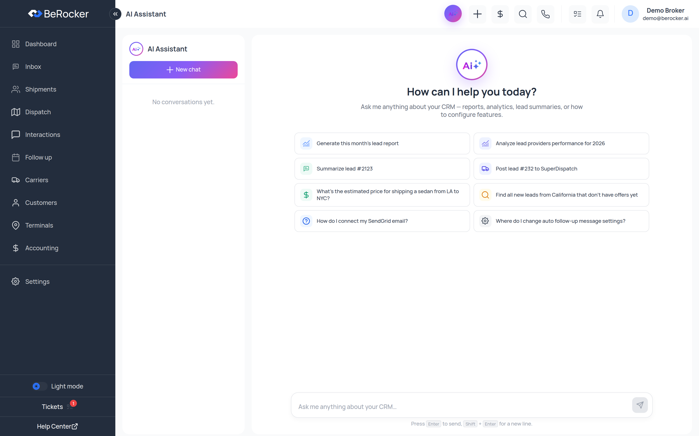

The **AI Assistant** answers questions about how BeRocker works and about your own data. Open it
with the **Ask AI** button in the top bar on a computer. On a phone, tap the round assistant button
beside your avatar, or open your avatar menu and tap **AI Assistant**.

<Frame>
  
</Frame>

---

## What Ask AI can answer

- **How do I…** questions. It searches this help site and gives you the steps, using the same
  names the screens use, with a button to open the right screen and a link to the article it used.
- **Reports and numbers**: dashboard figures, company performance, lead sources and pricing
  comparisons, read from your company's real data. It can also generate a report for you to download.
- **A lead**: details, conversation and calls for one lead (for example *Summarize lead #2123*), or a
  search across your leads.
- **Load boards**: it can show what would be posted for a lead on Super Dispatch or Central Dispatch,
  and post, repost or remove a listing once you confirm the preview.
- **Marketing** (only when Marketing is turned on for your company and your role can open it): how
  campaigns are doing, the reply inbox and the campaign list. It reads only; it does not change
  anything in Marketing.

It answers in the language you write in.

---

## Start a new chat and use the suggestions

A new chat shows **What do you want to set up?** with small suggestion buttons. Each one sends a full
question for you:

- **Connect my phone system**
- **Set up email sending**
- **Add a team member**
- **Connect a lead provider**
- **How auto-pricing works**
- **Change follow-up messages**
- **This month's lead report**
- **Summarize lead #2123**

Or type your own question in the box (**Ask me anything about your CRM…**). **Enter** sends,
**Shift + Enter** starts a new line, and one message can be up to 5,000 characters. While an answer
is coming, the send button waits until it is finished.

---

## Voice typing with the microphone

Where your browser supports speech recognition, the box has a microphone button. Tap it and talk;
your words land in the box at the cursor, next to anything you already typed. Nothing is sent until
you press send, and no audio is kept.

- **Turning on:** you hear two short rising notes. The box says *Starting the microphone…* until it
  is really listening, then *Listening… speak now*. The bars move only while it hears you.
- **Turning off:** tap the microphone again, or send the message. You hear two falling notes.
- **Stopping by itself:** after 12 seconds without a word, or after 3 minutes in one go. Switching to
  another tab or app also stops it.
- On Android the phone plays its own sound instead of these notes.

If it cannot listen, it says why under the box, and you hear two low notes:

| Message | What to do |
| --- | --- |
| *The microphone is blocked. Allow it for this site in your browser, then tap the microphone again.* | Allow the microphone for BeRocker in your browser's site settings. |
| *The microphone is blocked. On an iPhone, turn on Dictation in Settings, General, Keyboard, and allow the microphone for this site in Safari.* | On an iPhone, turn on **Dictation** in **Settings → General → Keyboard**, and allow the microphone for the site in Safari. |
| *No microphone was found.* | Connect or enable a microphone. |
| *Nothing was heard. Check your microphone, then tap it to try again.* | Check the right microphone is selected and not muted. |
| *The microphone did not start. Tap it to try again.* | Tap the microphone again. |
| *Voice typing needs an internet connection. Check it and try again.* | Your browser's speech service needs the internet. |
| *Voice typing is not available in this language on this device.* | Type instead, or change your device language. |
| *That is as long as one message can be.* | The box is full (5,000 characters). Send it and continue in a new message. |
| *Voice typing stopped unexpectedly. Tap the microphone to try again.* | Tap the microphone again. |

If you do not see a microphone at all, your browser does not offer speech recognition. Type your
question instead.

---

## How an answer arrives: Thinking and Worked for

While the assistant works, a small moving figure shows the word **Thinking**, with the step it is on
underneath (for example the report it is reading). The answer then appears word by word.

When the answer is finished, the steps fold into one line such as *Worked for 2 steps · 3.4 s*.
Click the line to see each step, with a tick or a cross and how long it took.

Answers are formatted with numbered steps, bold screen names, tables and short notes. When a help
article has a screenshot of the screen, it can appear in the answer; click it to open it full size.
A report ready to download appears as a card with **Click to download**.

---

## Buttons under an answer, copy and rating

Under an answer you may see buttons that do the next thing for you:

- **Open a screen**: takes you straight to the page or settings tab the answer is about. These only
  ever point at screens that exist.
- **A follow-up question**: sends the likely next question with one click.
- **The help article** the answer was built from (usually **Open the guide**), opened in a new tab.

If another answer is still coming, the buttons wait until it is finished.

Below every finished answer:

- **Copy** puts the answer on your clipboard (the icon briefly turns into a tick).
- **Good answer** (thumbs up) and **Bad answer** (thumbs down). Thumbs down asks
  **What was wrong?** with **Wrong**, **Not what I asked**, **Too long** and **Could not do it**, or
  **×** to skip. Click the same thumb again to take your rating back.

---

## When an answer fails: Try again

If no answer comes back, the reply shows one sentence saying why, with a **Try again** button. Try
again asks the same question once more without showing it twice. Nothing is saved for the failed
answer.

| Message | What it means |
| --- | --- |
| *The assistant could not be reached.* | The AI service did not respond. Wait a moment and try again. |
| *The assistant took too long to answer.* | The answer was not finished in time, usually on a big question. Try again, or ask for less at once. |
| *The assistant came back with nothing.* | The AI returned an empty answer, even after one automatic retry. Try again. |
| *That took too many steps to answer. Try asking for one thing at a time.* | The question needed too much work in one go. Split it up. |
| *Something went wrong on our side.* | An unexpected error. Try again; if it keeps happening, open a support ticket. |

See also [Troubleshooting](/support/troubleshooting).

---

## Your chats: search, pin, rename and delete

On a computer your chats are in the left column under **AI Assistant**. On a phone, tap the menu
button at the top to open **Chats**, and **+** to start a new one.

- **New chat** starts a fresh conversation.
- **Search chats** finds a chat by name.
- Chats are grouped as **Pinned**, **Today**, **Yesterday**, **Last 7 days** and **Older**. More load
  as you scroll.
- On each chat: **Pin** keeps it at the top (**Unpin** to undo), **Rename** lets you type a new name
  (Enter saves, Esc cancels), and **Delete** removes it after you confirm. A deleted Ask AI chat is
  removed permanently.

---

## What Ask AI cannot do

- **It does not change your data without your confirmation.** For a load board post it always shows
  a preview first and acts only after you say yes. Read the preview.
- **It does not guess setup steps.** If the help site has no guide for something, it says so. When it
  knows the screen exists, it tells you where it is and gives you a button to open it; when it cannot
  confirm a feature, it says so and points you to **Support tickets**.
- **It only sees your company.** It cannot see another company's leads, and it respects the same
  limits your account does.

---

## The same thing outside the CRM

If you would rather ask from Claude, ChatGPT or another AI tool you already use, BeRocker offers the
same kind of answers over MCP. See [Connecting BeRocker to Claude (MCP)](/integrations/mcp/mcp-connection).

---

## Related

<CardGroup cols={2}>
  <Card title="MCP connection" icon="plug" href="/integrations/mcp/mcp-connection">
    Use BeRocker from Claude or ChatGPT.
  </Card>
  <Card title="Dashboard" icon="chart-line" href="/using/dashboard">
    The same numbers as charts.
  </Card>
</CardGroup>
