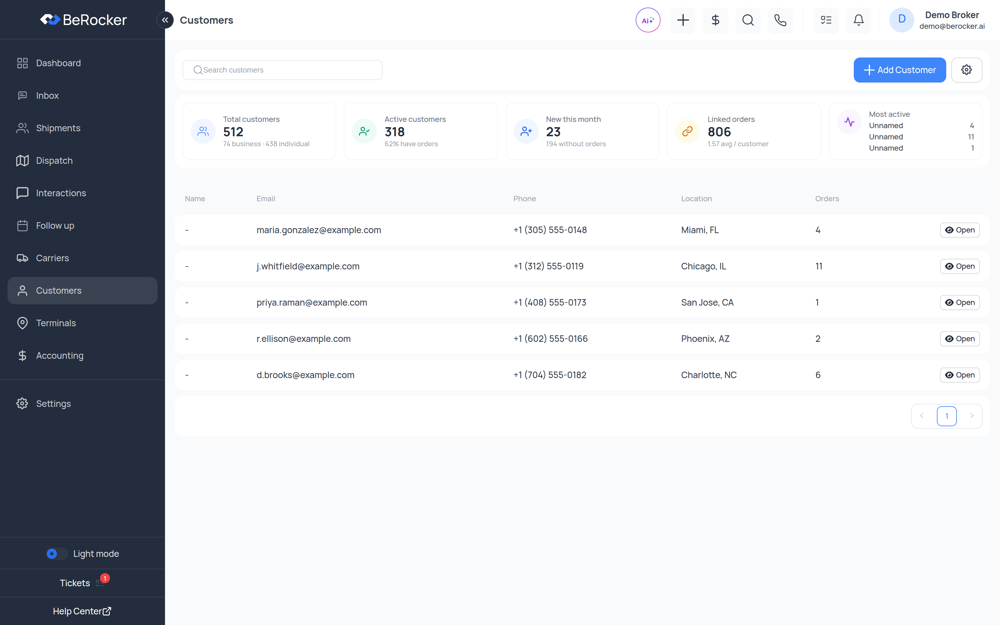

**Customers** is the person or company behind the shipments. One customer can have many orders, so
a repeat shipper is one record with a history rather than five unrelated leads.

Open it from **Directories → Customers** in the sidebar. When the sidebar is folded to icons,
hover the Directories icon to pick **Customers**.

<Frame>
  
</Frame>

---

## The list

The stats strip counts your book: **Total customers**, **Active customers**, **New this month**
and **Linked orders**, plus your **Most active** customers.

The table shows **Name**, **Company**, **Type**, **Phone**, **Email**, **Location**, **Orders** and
**Added**; **Manage columns** chooses which are shown. The **Search customers** box finds one by
name, and **Add Customer** creates one by hand.

---

## Individual vs business

A customer is either an **individual** (first and last name) or a **business** (company name). A
business can hold several contacts (dispatcher, accounts payable, the person who actually answers
the phone), with one of them marked **Primary**.

---

## The customer profile

Open a customer to see their name, type, email, phone and location, with **Edit** and a delete
button (each shown only to roles allowed to change or delete customers). Four tabs sit below:

<Tabs>
  <Tab title="Orders">
    Every shipment for this customer, with **Order**, **Status**, **Route** and **Date**. Click
    one to open its conversation (orders without a conversation cannot be opened from here).
  </Tab>
  <Tab title="Contacts">
    All the people at this customer. Add as many as you need and mark one as **Primary**.
  </Tab>
  <Tab title="Notes">
    Free-text notes your team can see: payment habits, preferred pickup windows, anything that
    does not fit a field. Write one and click **Save note**.
  </Tab>
  <Tab title="Payments">
    Securely saved cards for this customer, with **Active** on the one in use. Roles that can
    manage cards can add or remove one here.
  </Tab>
</Tabs>

---

## Start a quote or order for a customer

On a customer's page, click **New Quote / Order** at the top. If the customer has no orders yet,
the **Orders** tab also offers **Create the first quote**. You need permission to add shipments.

1. **Add Shipment** opens already filled in with this customer.
2. Add the route, vehicles, dates and price, as on the [Shipments](/using/shipments) screen.
3. Save. You are usually taken straight to the new shipment's conversation; if not, it appears on
   the customer's **Orders** tab.

---

## Merging duplicates

The same person will eventually come in twice: once from your website and once from a provider.
**Customer consolidation**, in the menu next to **Add Customer**, finds groups of likely
duplicates (search them by name, email or phone), shows which record is recommended to keep, and
merges each group into it, one at a time or every group at once. Each merge can be undone
afterwards, and the orders from both come along.

---

## Importing customers

The same menu offers **Import customers from orders** (create customer records from the shipments
you already have) and **Import customers from SuperDispatch**. Bulk file import is under
**Settings → Lead Management → Import data**, alongside lead and terminal import.

---

## Related

<CardGroup cols={2}>
  <Card title="Shipments" icon="table" href="/using/shipments">
    The orders themselves.
  </Card>
  <Card title="Accounting" icon="dollar-sign" href="/using/accounting">
    What each customer has actually paid.
  </Card>
</CardGroup>
