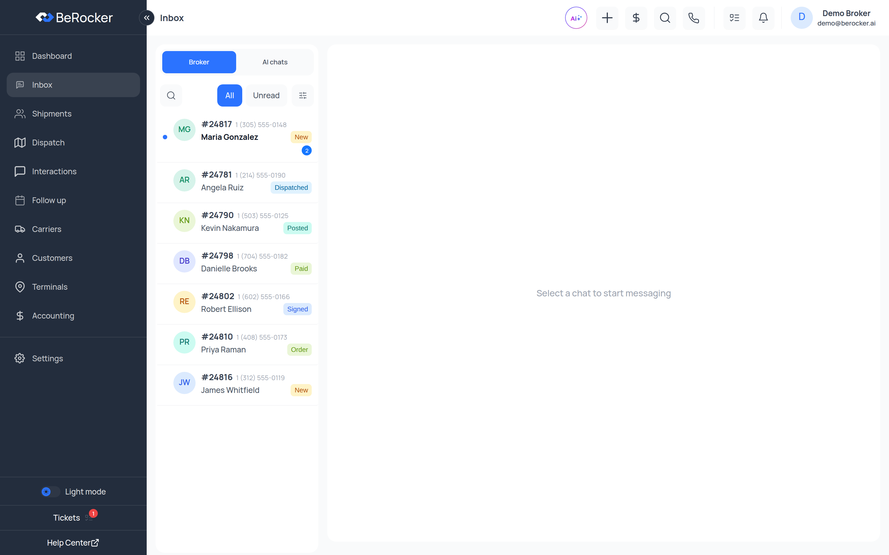
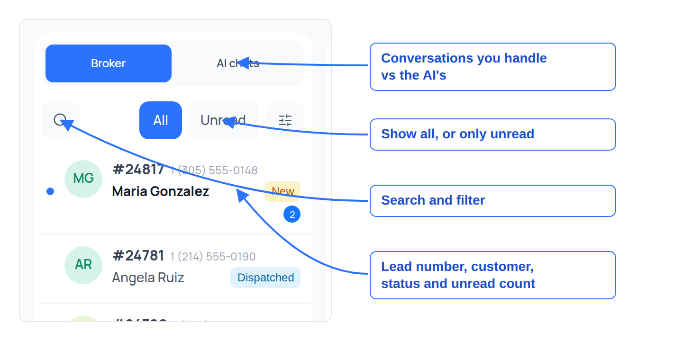
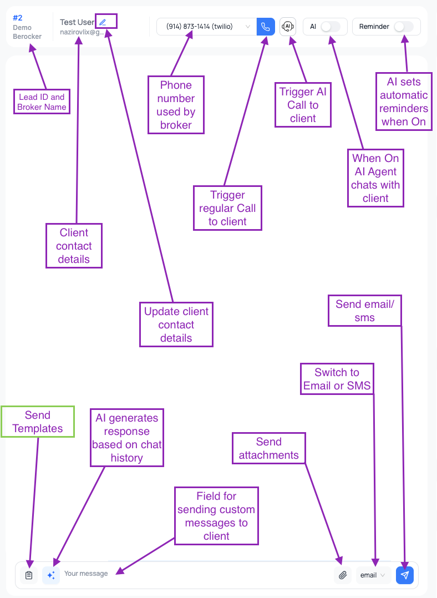
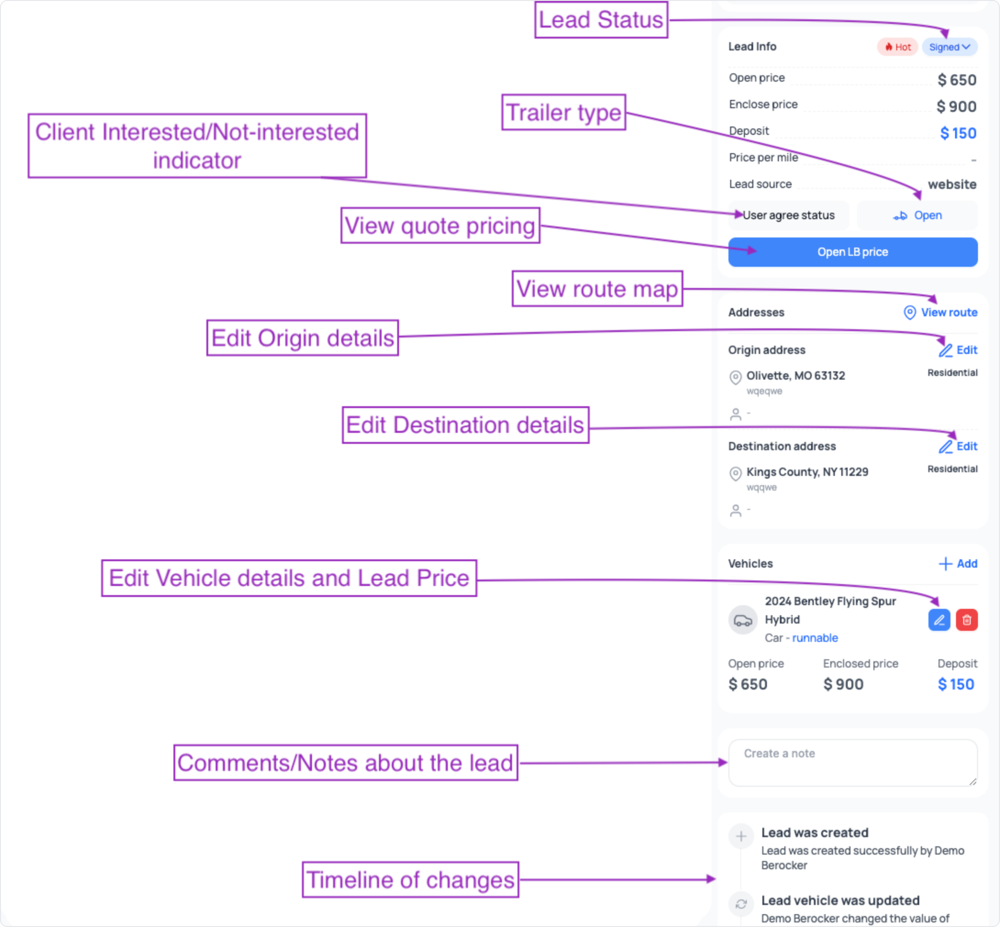
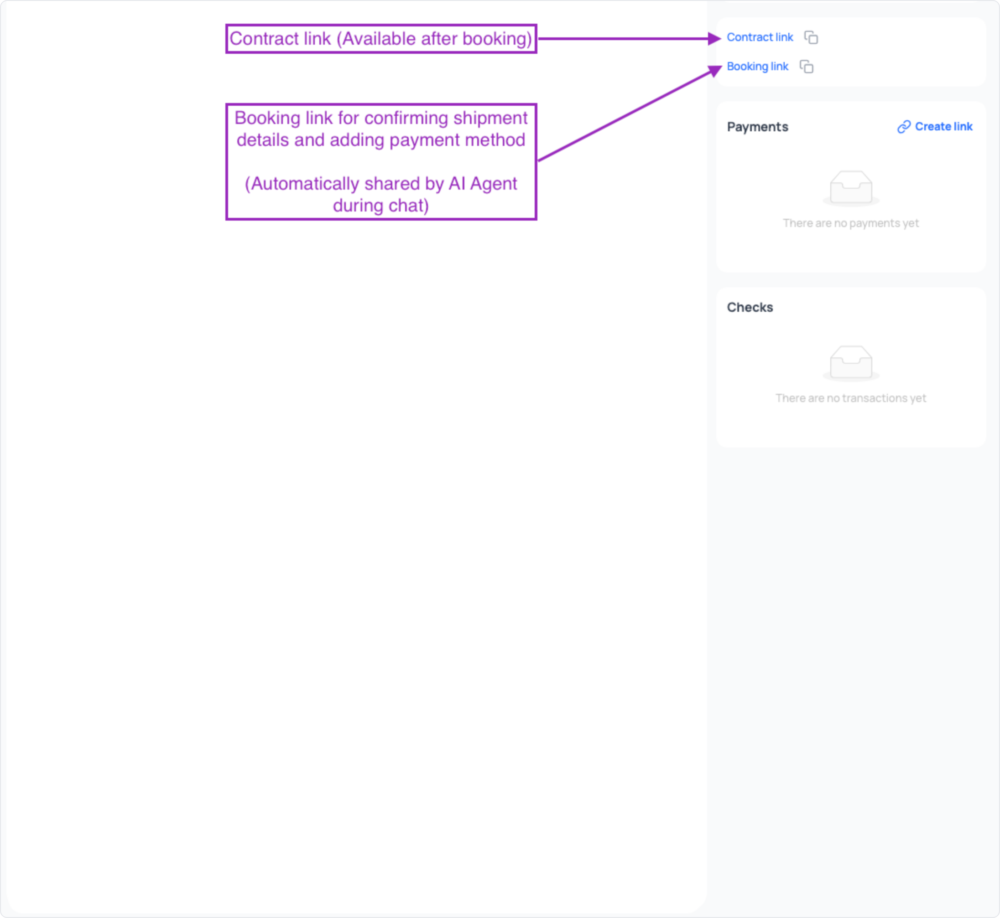
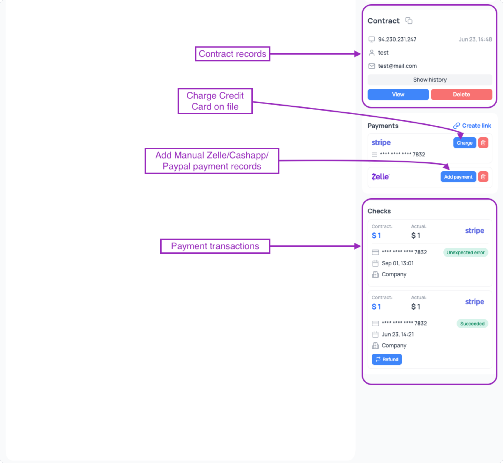
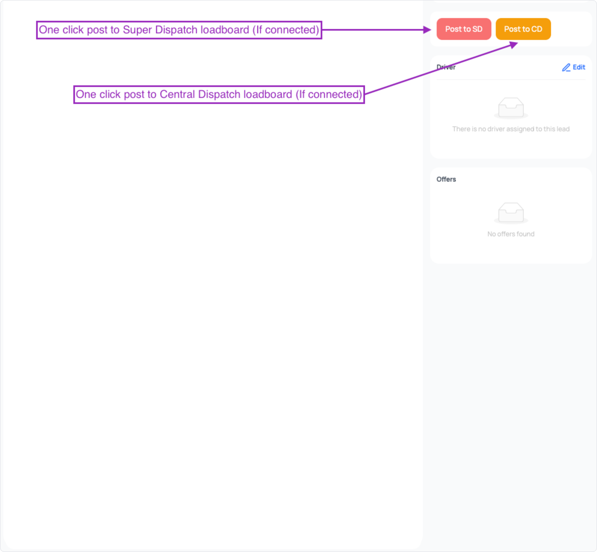
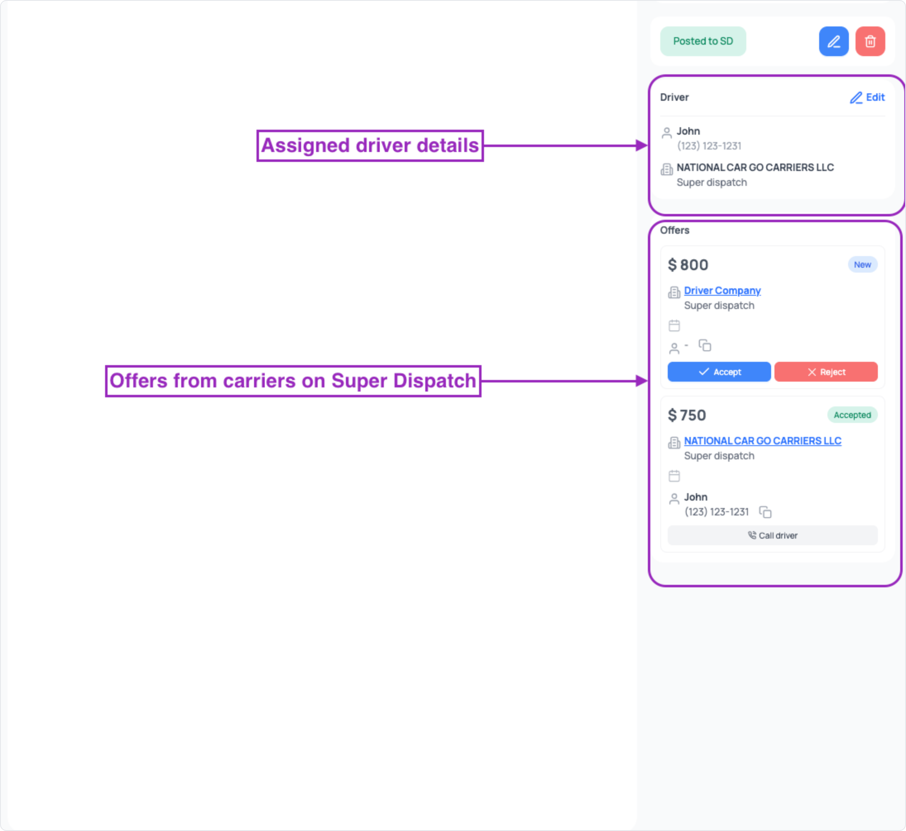

**Inbox** is where the work happens. Every lead has one conversation, and every SMS, email,
WhatsApp message, call and recording for that lead lives in it. The panel on the right holds the
shipment itself: its details, its booking and its carrier.

<Frame>
  
</Frame>

---

## The conversation list

<Frame caption="The controls at the top of the conversation list.">
  
</Frame>

| Control | What it does |
| --- | --- |
| **Broker / AI chats** | Switches between conversations a person is handling and conversations the AI is handling. |
| **All / Unread** | Shows everything, or only threads with unread customer messages. |
| **Search** | The magnifier opens a **Search conversations...** box. |
| **Whose conversations** | Shown if your role can see other people's conversations. Pick **My conversations**, **Everyone**, or one teammate. |
| **Filter** | Narrows the list to **Awaiting reply**, or to one lead status: **New leads**, **Order**, **Signed**, **Paid**, **Posted**, **Picked Up**, **Dispatched**, **Completed** or **Archived**. **Clear Filter** removes it. |

Each row shows the lead number, the customer's name and number, the last message, and a blue badge
with the count of unread messages.

---

## Who owns the conversation: you or the AI

Every conversation has a **responsible** party: either **AI** or **Worker** (you).

- While the AI is responsible it answers the customer using your templates and pricing.
- When you turn the **AI** switch off in the conversation header, the AI stops replying on that
  thread and you handle it.

Use the **Broker / AI chats** switch at the top of the list to see each set.

---

## The message thread

The middle column is the thread itself, newest at the bottom. It carries everything, not just
texts:

- **SMS, email and WhatsApp** messages, inbound and outbound.
- **Calls** (inbound, outbound and AI calls) with the recording and, where available, a
  **transcription** you can read instead of listening.
- **Files** such as photos, PDFs and documents, with previews.
- **Quotes and templates** that were sent, and which template version went out.

Above the thread sits the **conversation summary** bar: the deal stage and an AI headline of what
is going on. **Details** opens the full **Conversation summary**: the timeline of key moments, the
customer's **vibe**, what is blocking, and a **suggested reply**. It updates on its own as new
messages arrive.

---

## The conversation header and composer

<Frame caption="Everything around the message thread.">
  
</Frame>

**Along the top:** the lead number and the broker's name, the customer's contact details (with a
pencil to edit them), the **Interested / Not Interested** button (marking **Not Interested** stops
all further automated messages to that customer), the phone number you are calling from, a
**call** button, and the controls:

| Control | What it does |
| --- | --- |
| **AI** switch | When on, the AI Agent replies to this customer automatically. Turn it off to handle the chat yourself. |
| **AI Call** | Have the AI agent place a call. |
| **Reminder** switch | When on, the AI Agent sends follow-up reminders automatically if the customer stops responding. |
| **Follow-up messages** switch | When on, your follow-up sequence is sent to this customer over time. Turn it off to stop it; turn it back on to resume where it left off. |
| **Refresh conversation** | Reloads the thread. |
| **Schedule a follow-up call** (calendar icon) | Sets a time for your team to call this customer. Once set, the tooltip shows **Next call:** and the time. See [Schedule a follow-up call](/using/follow-up). |
| **Lifecycle logs** | The record of everything that happened to this lead. |

Some of these depend on your role, so not every role sees all of them.

**Along the bottom:** **Select template**, **Send quote**, **Generate response** (the AI drafts a
reply from the chat history), type a custom message, attach a file, switch between **SMS** and
**Email**, and send.

**Send quote** builds the quote from your [pricing](/settings/pricing) settings.

<Warning>
  If you see **"No SMS / email sender available"**, you have not set a default contact yet. Fix it
  in **Settings → Profile → User Contacts**. See [Profile](/settings/profile).
</Warning>

---

## The lead panel

The right-hand panel is the shipment itself, with three tabs: **Details**, **Booking** and
**Carrier**. The sections below describe each part.

<AccordionGroup>
  <Accordion title="Details tab">
    
  </Accordion>
  <Accordion title="Booking tab, before the customer books">
    
  </Accordion>
  <Accordion title="Booking tab, after booking">
    
  </Accordion>
  <Accordion title="Carrier tab, before posting">
    
  </Accordion>
  <Accordion title="Carrier tab, after posting">
    
  </Accordion>
</AccordionGroup>

---

## Lead Info: the price card on the Details tab

**Lead Info** at the top of the **Details** tab shows the money and the lead's state:

- **Total Price (Open Trailer)** or **Total Price (Enclosed Trailer)**, depending on the trailer
  type.
- **Price tier**, when your company uses price tiers. Click it to pick another tier; you are asked
  to confirm the new price.
- **Deposit (Profit Margin)**, **Ocean freight** (ocean shipping companies only) and **Carrier
  fee** (what is left to pay the carrier).
- **Price per mile**, **Lead source**, **Carrier payment** (how the carrier gets paid, as posted)
  and **Payment type** (what the customer chose at booking), when known.

The chips in the header show the customer's interest (**Interested** / **Not Interested**), **Hot**,
**Manual price** (a custom vehicle that must be priced by hand), the lead status, and a clock that
opens **Pricing history**.

If follow-up messages are on hold because the lead has no complete price, a note says
**Follow-ups aren't running.** Add the price, then turn **Follow-up messages** on in the chat
header.

Under the card are the **Actions** menu and one main button: **Convert to Order** on a new lead, or
**Update Price** on any other lead.

---

## Change a lead's status

Click the status chip in the **Lead Info** header and pick a status. Your role needs permission to
update leads.

- Choosing **Paid** when no payment has succeeded asks **Payment not completed**. Click **Yes,
  change** to go ahead.
- Choosing **Dispatched** when no carrier is attached opens **Attach Carrier**, where you search
  for and pick the carrier first.

---

## Convert a lead to an order

On a new lead, **Convert to Order** on the **Details** tab turns it into an order in four steps.
Your role needs permission to update leads.

1. **Details**: check and edit **First name**, **Last name** and **Email** (click **Save details**
   to save them on the spot). The phone, trailer, vehicles and the payment option the customer
   picked (**Customer selected**) are shown but not edited here. Set the **Pickup date**. Check
   **Total price**, **Deposit** and **Carrier fee**, and click **Edit pricing** to change them.
2. **Pickup**: search the address or type the **Street address**, **City**, **State** and
   **ZIP**. Turn off **Residential address** to enter a business name. **Additional details**
   holds the contact person, phone, an additional phone and **Pickup notes**.
3. **Drop-off**: the same fields for the **Drop-off address**, with **Delivery notes / special
   instructions**.
4. **Payment**: add or pick a **Card on file** if you want, and choose **Include deposit &
   profit on contract**, **Include insurance on contract** and **Email booking confirmation to
   customer**.

Click **Convert to order**. You see **Order confirmed**, with **View order document (PDF)**. If
you ticked the confirmation, the customer is emailed a booking confirmation. The lead now shows
*Converted to order by* your name and the time.

Each address needs street, city, state, ZIP, contact name and phone (and a business name when it
is not residential); the wizard tells you what is missing. If a card you entered cannot be saved,
the order is not created.

---

## The Actions menu on a lead

Click **Actions** on the **Details** tab. Items depend on your role.

| Item | What it does |
| --- | --- |
| **Update Price** | Shown here on new leads, where **Convert to Order** takes the main button. Opens the price form. |
| **Get Pricing Estimate** | Opens **Load board price**. See [Get a pricing estimate](#get-a-pricing-estimate-for-a-lead). Needs permission for Super Dispatch or Central Dispatch pricing. |
| **Change to Enclosed Trailer** / **Change to Open Trailer** | Switches the trailer type. The total price shown switches to the matching price. |
| **Switch to Full Payment** / **Switch to Reservation Only** | Changes the customer's payment plan. See [Switch the payment plan](#switch-a-lead-between-full-payment-and-reservation-only). |
| **Pricing history** | Every price change on the lead. |
| **Reassign** | Moves the lead to another user. See [Reassign a lead](#reassign-a-single-lead). |

---

## Get a pricing estimate for a lead

**Actions → Get Pricing Estimate** opens **Load board price** with up to three tabs:

- **BeRocker AI Price**: always available. Shows **Carrier fee**, **Deposit** and **Total** for
  open and enclosed trailers.
- **Super dispatch**: needs permission for Super Dispatch pricing and Super Dispatch pricing access
  on your account. Shows the recommended price per vehicle, with its confidence, range and expected
  time to dispatch where available.
- **Central dispatch**: needs permission for Central Dispatch pricing, Central Dispatch connected
  in **Settings → Pricing**, and the Market Intelligence add-on on your Central Dispatch account.
  Shows the market price and current listings per vehicle.

Click **Apply prices to lead** to write those prices onto the vehicles. The window closes. A tab
you have no permission for is greyed out.

---

## Switch a lead between Full payment and Reservation only

**Actions → Switch to Full Payment** (or **Switch to Reservation Only**) changes what the customer
is charged. Your role needs permission to update leads.

1. The **Switch payment plan** window says which plan the order is on and which it moves to.
2. Leave **Send the customer a new contract to sign** on to send a contract with the new terms, or
   turn it off to change the plan without contacting the customer.
3. Click **Switch to Full payment** (or **Switch to Reservation only**).

If a contract is already signed or awaiting signature, the window changes to **Void the current
contract?**. The old contract stays on file as voided (nothing is deleted) under **Booking →
Contract**. Click **Void contract & switch**. If you cannot void contracts, the window says **You do
not have permission to void contracts**: ask a teammate with contract permissions to void it, then
switch the plan.

---

## See a lead's pricing history

Click the clock in the **Lead Info** header, or **Actions → Pricing history**. **Pricing History**
lists every recorded price change with its **Total price**, **Deposit**, **Carrier fee** and
**Ocean freight**. If nothing changed yet it says *No pricing changes have been recorded for this
lead yet.*

---

## Reassign a single lead

**Actions → Reassign** opens **Reassign lead**. Pick the user and click **Reassign**.

<Warning>
  The lead's contact settings switch to the new user. The customer starts receiving messages from
  the new user, so to them it looks like a different number or sender.
</Warning>

To reassign many shipments at once, use **Select rows** on the [Shipments](/using/shipments)
screen.

---

## Change the lead source

On **Lead Info**, click the pencil next to **Lead source** (tooltip **Change the lead source**),
pick a source from **Select source**, and it saves at once (**Lead source updated**). **Cancel**
leaves it as it was. Your role needs permission to update leads. Use this when a lead came from a
source you added later, so source reports stay right.

---

## Edit a lead's addresses

The **Addresses** card on the **Details** tab shows origin and destination, **Pickup date**,
**Drop-off date** and **Total mileage**. Click **Edit** on either address (needs permission to
update addresses) to open **Edit Address**, with **Origin** and **Destination** tabs.

Fields: **Location (City or Zip)** (or **Port**, when **Ships through a port** is ticked on ocean
shipping accounts), **State**, **City**, **Zip**, **Address**, **Is residential** (turn off to
enter a **Business name**), **Pickup date** or **Drop off date**, **Contact name**, **Phone**,
**Buyer number**, **Additional phone** and **Comment**. Click **Save**.

### Fill an address from favorites

In **Edit Address**, click **Fill from favorites**. The **Favourites** list shows saved places with
their contact. Search it, click one to fill the address, or click the bin to remove it from
favorites.

### Add an address to favorites

In **Edit Address**, click **Add address to favorites** (needs permission to add favorites), give
it a name, and click **Save**. It then appears under **Fill from favorites** for everyone.

---

## View a lead's route on a map

Click **View route** on the **Addresses** card. **View map** opens with an **Overview** tab showing
the route, and an **Origin / Destination** tab with a map of each exact address when both are
known.

---

## Add and edit vehicles on a lead

The **Vehicles** card lists each vehicle with its type, whether it runs, its VIN and its prices.
Click **Add** (needs permission to add vehicles) to open **Add new vehicle**, or the pencil on a
vehicle to open **Edit vehicle**.

1. Type the **VIN** (17 characters). The VIN is decoded and a **Decoded from VIN** panel shows what
   was found, and the year, make and model are filled in.
2. Or pick **Vehicle model year**, **Vehicle make**, **Vehicle model** and **Vehicle type**.
3. Tick or untick **Vehicle runs & drives**.
4. Leave **Price open**, **Price enclosed** and **Deposit** blank to have them estimated, or type
   them. On a higher price tier, enter the Tier 1 price; the tier markup is added for you.
5. Click **Ok**.

When adding, **Qty** adds several of the same vehicle at once; add their VINs later from **Edit
fleet**.

The bin on a vehicle removes it after you confirm (needs permission to delete vehicles).

### Vehicle not in the catalog

If the make or model is not in the list, tick the **Not in our catalog** box and type the year,
make and model yourself; they are added for you. Or click **Add to catalog** to open **Add Custom
Vehicle** and add it. A vehicle entered by type only shows **Needs make & model**: add the year,
make and model before posting it to a load board.

### Vehicle images

Click a vehicle's picture to open **Vehicle Images**, the photos stored for that vehicle.

---

## Edit a fleet of the same vehicle

When a lead has two or more of the same vehicle, they are grouped in one line with counts such as
VINs added, inoperable and vehicles that differ. Click **Edit fleet** (needs permission to update
vehicles) to change them all in one form:

- **Vehicle**: year, make and model, and **Apply to** how many of them.
- **Price**: **Each** or **Total**, and **Deposit each**.
- **How many**: **Add more** (new ones copy this line's vehicle and price) or **Remove**.
- **Condition**: how many are **Inoperable**.
- **VINs**: paste one VIN per line.

Click **Apply**.

---

## Tag a lead

The **Tags** card on the **Details** tab shows the lead's tags. Click **Add** to pick tags (needs
permission to assign tags). A lead can carry up to the set maximum of tags; at the limit, remove
one to add another. Click the cross on a tag to remove it.

### Manage tags

The small settings button on the **Tags** card (tooltip **Create or delete tags**) opens **Manage
tags**. Shown to roles that can create or delete tags. Type a **Tag name**, pick a colour and click
**Create**. To delete a tag, click its bin and confirm; the warning says how many shipments carry
it, and deleting removes it from all of them. Your company has a maximum number of tags.

---

## Add notes to a lead

The **Notes** card on the **Details** tab holds your team's notes. Shown to roles that can update
leads.

1. Click **Add note**.
2. Pick a type: **Comment**, **Accounts Receivable** or **Dispatch Note**.
3. Write the note and, if needed, **Attach file** (JPG, PNG, PDF, DOC or DOCX).
4. Click **Save**.

The card shows the latest notes; **Show all** lists every note and **Latest** goes back. Delete a
note with its bin after confirming. If the lead came from an email, **View email** shows the
original email with its attachments.

The **Customer comments** card shows what the customer wrote when they asked for a quote.

---

## The lead timeline

At the bottom of the **Details** tab, the timeline lists every change made to the shipment. Click
**Show more** to see all of it.

---

## Contracts on the Booking tab

The **Contract** card on the **Booking** tab shows the current contract: who signed, their email,
the IP address and the time. A tag shows **Awaiting signature** or **Voided**, and the version
(for example *v2 of 3*) when there is more than one.

- **View** opens the contract. Contracts cannot be deleted.
- **Show history** opens **Client visits histories** (see below).
- Before any contract exists, **Contract link** and **Booking link** open or copy the links you can
  send the customer.

### Issue a new contract

When the order changed after signing (a price fix, an inoperable vehicle, a new payment plan),
click **Issue new contract** (needs permission to void contracts). The new contract is built from
the order's current price, vehicles, payment plan and addresses. A signed contract is voided, not
deleted, and stays in the history. Optionally write **Why is a new contract needed?**, choose
**Send the customer the signing link**, and click **Issue new contract**.

### Previous contract versions

**Previous versions** lists older contracts with their status, date and reason. **View** opens one.
**Make active** (needs permission to change the active contract) makes it the governing contract;
the current one is stood down and kept in the history.

---

## See when the customer opened their links

On the **Booking** tab, click **Show history** under the contract to open **Client visits
histories**: each visit with **Client ID**, **Page** and **Created at**. Use it to check whether the
customer opened the booking or contract page. Shown to roles that can see lead visits.

---

## Cards on file

The **Payment methods** card on the **Booking** tab lists saved cards and other methods, with
**Active** on the one in use. Click **Add card on file** (or **Manage cards on file** when one
exists) to add a card or remove one. Cards the customer gave on another order appear under
**Saved for this customer** so you can use them here. Shown when your role can create payment links
and your payment gateway supports cards on file.

On a saved method, **Charge** opens **Charge payment**: enter the **Amount** (any card fee is
shown), a comment and the **Purpose type** (**Full shipment cost**, **Deposit / first payment** or
**Additional charge**). On a manual method (Zelle, Venmo, PayPal, Cash App or other) the button is
**Add payment** and records money already received. Needs permission to charge.

**Attach receipt** records a manual payment with its **Payment method**, **Amount**, purpose and a
receipt file.

---

## Payment links

**Create link** on the **Booking** tab opens **Create link**. Enter the amount and purpose and
submit; the link is created and copied to your clipboard (if the browser blocks the copy, copy it
from the window). Needs permission to create payment links, and a gateway that supports links.

The **Payment links** card lists every link with its state: **Live**, **Expired**, **Paid**,
**Cancelled** or **Failed**, how many are live and how much is outstanding. On an open link:
**Copy**, **Send** (**Text the customer** or **Email the customer**) and **Cancel** (a link
already sent stays payable until the gateway expires it).

---

## Transactions and refunds

The **Transactions** card lists every payment with its amount, method, status and any error. Click
a transaction for the cardholder, billing address, comment and **Receipt**. **Refund** (needs
permission to refund) opens **Refund**: choose **Full** or **Partial**, enter the amount for a
partial refund, give a reason (required) and confirm.

---

## Post a load to a load board

On the **Carrier** tab, the posting buttons show for boards that have no post yet. Your role needs
permission to post.

- **Post in one step to Super Dispatch & Central Dispatch** (shown when both are connected and
  neither has a post) opens **Post to Super Dispatch & Central Dispatch**. Click **Post to both**.
- **Post to Super Dispatch** opens **Post to Super Dispatch Loadboard**. Click **Post**.
- **Post to Central Dispatch** opens **Post to Central Dispatch**.

The forms hold the tariff, deposit, carrier price, payment method and terms, dates and
instructions. **Learning Mode** in the Super Dispatch form shows a short explanation on every
field. A board that is not connected shows **Not connected**; connect it in **Settings →
Integrations**.

Once posted, each board shows a card such as **Posted to Super Dispatch**, **Dispatched on**,
**No longer posted to**, **Order only, not listed on** or **Failed to post to**, with:

- The pencil: **Edit details & update the post**. Not offered once the load is picked up or
  delivered, or when the load already has a carrier.
- The bin: **Remove post from the load board**. Not offered once the load is picked up or
  delivered.
- For Central Dispatch, how long the listing stays up (Central Dispatch removes listings on the
  delivery date) and **Post to CD again** for an expired listing.
- For Super Dispatch, **Super Dispatch BOL**, **Delivery BOL** and **Proof of Delivery** when
  available.

If a carrier was secured on the other board but this post is still active, a warning asks you to
**Delete post** so the load is not picked up twice.

---

## Dispatch to a carrier without posting

To send a load to one carrier instead of advertising it, use the line under the post buttons:
**Dispatch to a Super Dispatch carrier without posting** (or the Central Dispatch one), or **Dispatch
to a carrier without posting** with a choice of board when both are connected. If the button is
greyed out, its tooltip says what is missing.

- Super Dispatch: fill **Dispatch to a carrier**, click **Create order & choose carrier**, then
  search for the carrier (or pick one under **Recently dispatched**) and click **Send offer**.
- Central Dispatch: fill **Dispatch to a Central Dispatch carrier** and save.

On a posted Super Dispatch load, **Dispatch to carrier** does the same from the post card. On a
Central Dispatch post, **Dispatch to CD** records the carrier; afterwards the card shows
**Dispatched to CD**, with buttons to edit or remove the dispatch and **Open in CD**.

---

## Retract an offer sent to a carrier

While a Super Dispatch offer is waiting, the post card shows **Awaiting acceptance** with the
carrier's name. Click the retract button (**Retract offer**) and confirm. The load goes back to
needing a carrier. Once the carrier accepts, the card shows **Dispatched to** and the carrier.

---

## Handle carrier offers

The **Offers** card on the **Carrier** tab lists the requests carriers sent, with the requested
price compared to your posted price, their proposed dates and their note. Click **Sync SD** to pull
the latest from Super Dispatch.

- **Accept** takes the offer (needs permission to accept offers). Not possible once the load is
  dispatched.
- **Counter** (Super Dispatch offers only) opens **Send counter offer**: enter your price and click
  **Send counter**. While it waits, **Cancel counter** withdraws it; the carrier's original request
  stays open.
- **Reject** opens **Decline offer** with a message to the carrier; click **Send** (needs
  permission to decline offers).

Once an offer is accepted it is pinned on top and the rest fold into **Other offers**. Rejected
and declined requests are hidden; turn on **Show rejected** to see them.

### Offer details and blacklisting a carrier

Click the carrier's name on an offer to open **Offer details**: the offer, the carrier's contact,
MC and DOT numbers, status, rate and documents. **Add to blacklist** blocks that carrier after you
confirm.

---

## Dispatch history and dispatching again

When a load has changed carriers, **Dispatch history** under the offers lists each attempt: the
carrier, MC number, phone, price, driver, when and by whom it was dispatched and how it ended. On a
past carrier, **Dispatch again** starts a new dispatch to that carrier.

---

## Live tracking of a load

When Super Dispatch shares tracking for a load, the **Live tracking** card on the **Carrier** tab
shows **Pickup ETA**, **Delivery ETA** and **Driver location**, each with when it was updated.
Click **View on map** to open **Driver location**. Until the driver shares an update, the card says
it is watching the load.

---

## Carrier money on a lead

On the **Carrier** tab:

- **Payment arrangement** sums up how the customer and the carrier are paid and the balance.
  **Agreed with carrier** shows the agreed carrier fee and any difference.
- **Carrier money** (shown to roles that can see accounting) opens with **Show what we owe the
  carrier**: the carrier fee, what the driver collects at the door, what was paid, adjustments,
  **Owed to the carrier** and the load margin.

**Record payment** opens **Record carrier money**. Pick **Paid to carrier**, **Carrier paid us** or
**Adjustment**, then the **Amount**, **Date**, **Method**, **Reference** and a **Note** (a reason is
required for an adjustment). Click **Save**. A recorded payment can be voided with a reason. The
button shows only to people allowed to record. If carrier payment tracking is off, the card says to
switch it on in **Accounting → Payables & Receivables**.

---

## Drivers and carrier verification on a lead

The **Driver** card shows the driver on the load, with **Add** or **Edit** depending on your role.
**Carrier verification** shows verification reports for the carrier, with **Verify** links.

---

## Calling from the Inbox

Click the phone icon on a conversation to call the customer with whichever provider you have
connected: Twilio, RingCentral, Telnyx, Vonage or Zoom Phone. The call is recorded against the
conversation, so the recording and transcript land in the thread when it ends.

Your call history and dialer are also always available from the phone icon in the top bar.

---

## Related

<CardGroup cols={2}>
  <Card title="Follow up" icon="inbox" href="/using/follow-up">
    Who to answer or call next.
  </Card>
  <Card title="Interactions" icon="phone-slash" href="/using/interactions">
    Calls and texts from numbers not yet matched to a lead.
  </Card>
  <Card title="Templates" icon="message" href="/settings/templates">
    The messages you send from here.
  </Card>
  <Card title="Messaging health" icon="heart-pulse" href="/settings/messaging-health">
    Why a text has not gone out yet.
  </Card>
</CardGroup>
