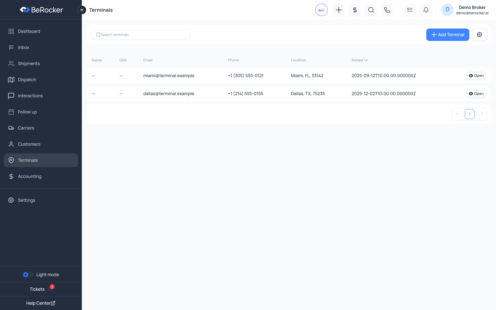

**Terminals** is your list of yards, storage lots, auctions, ports and any other fixed location you
ship in and out of, so an agent picking a terminal on a shipment is choosing from a list you
maintain instead of retyping an address.

Open it from **Directories → Terminals** in the sidebar. When the sidebar is folded to icons,
hover the Directories icon to pick **Terminals**.

<Frame>
  
</Frame>

---

## A terminal record

| Field | Notes |
| --- | --- |
| **Name** and **DBA name** | The legal name and the name everyone actually uses. |
| **Address**, **City**, **State**, **ZIP** | Used on dispatch sheets and driver instructions. |
| **Contact name**, **Phone**, **Email** | The on-site contact. |
| **Notes** | Internal notes: gate hours, where to check in, which door. The things drivers call about. |

The list shows **Name**, **DBA**, **Location**, **Phone**, **Email** and **Added**, with a **Search
terminals** box and an **Add Terminal** button.

---

## The terminal profile

<Tabs>
  <Tab title="Orders">
    Every shipment that has picked up from or delivered to this terminal.
  </Tab>
  <Tab title="Contacts">
    All the people at this terminal, with one marked **Primary**.
  </Tab>
</Tabs>

---

## Hawaii and ocean shipping

Shipping to and from Hawaii is set up in **Settings → Business → Hawaii shipping**: one switch,
the islands you serve and the ocean freight price for each. That is separate from terminals. See
[Hawaii shipping](/settings/business#hawaii-shipping).

---

## Importing terminals

**Import terminals from SuperDispatch** is in the menu next to **Add Terminal**. Bulk file import is
under **Settings → Lead Management → Import data**.

---

## Related

<CardGroup cols={2}>
  <Card title="Customers" icon="user" href="/using/customers">
    The other half of the address book.
  </Card>
  <Card title="Shipments" icon="table" href="/using/shipments">
    Where terminals get used.
  </Card>
</CardGroup>
