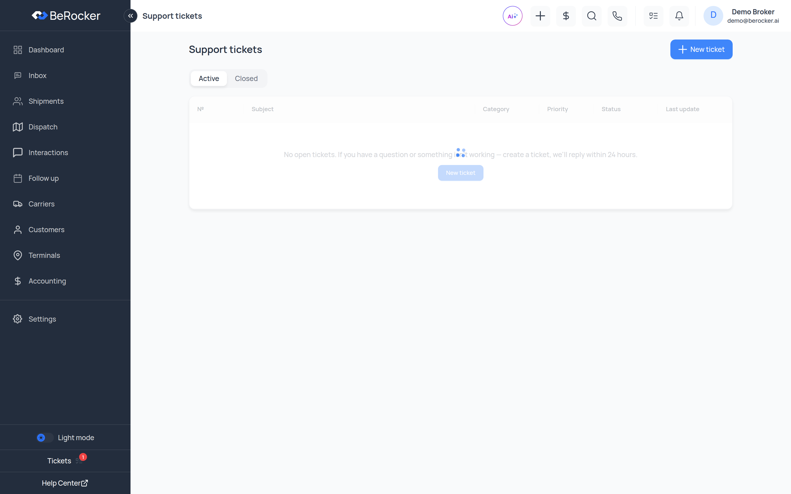

**Support tickets** is a direct line to the BeRocker team inside the product. Use it when something
needs a paper trail, such as a bug, a configuration change or a billing question, rather than a
quick "how do I…".

Open it from the **Help** button (the question mark) at the bottom of the sidebar, then
**Support tickets**. The Help menu says *Ask our team. We reply within 24 hours*.

<Frame>
  
</Frame>

When the team has replied and you have not read it yet, a number shows on the **Help** button and
next to **Support tickets** in the menu.

---

## Raise a support ticket

<Steps>
  <Step title="Click New ticket">
    On the **Support tickets** page, click **New ticket**.
  </Step>
  <Step title="Fill it in">
    - **Subject** (required): one line saying what is wrong, up to 150 characters.
    - **Category** (required): **Technical issue**, **Onboarding**, **Billing** or **Other**.
    - **Priority**: **Low**, **Normal**, **High** or **Urgent**. It starts at Normal.
    - **Description** (required): what you expected, what happened, and which lead or screen it
      happened on.
    - **Email for replies** (optional): if you add an email, support replies are also sent there.
      Leave it empty if you do not need email replies.
    - **Attachments**: **Add files (up to 5, 10 MB each)**. Screenshots and screen recordings cut
      resolution time more than anything else.
  </Step>
  <Step title="Click Create ticket">
    The ticket gets a number and appears under **Active**.
  </Step>
</Steps>

---

## The ticket list

The list has two tabs, **Active** and **Closed**, with the columns **№**, **Subject**,
**Category**, **Priority**, **Status** and **Last update**. Click a row to open the ticket.

---

## Ticket statuses

| Status | Meaning |
| --- | --- |
| **Open** | Received, not picked up yet. |
| **In progress** | Someone is working on it. |
| **Waiting** | The team needs something from you before it can continue. |
| **Deferred** | Parked, usually waiting on a release or a third party. |
| **Resolved** | Support believes it is fixed. |
| **Closed** | Finished. You can no longer reply. |

<Tip>
  A ticket in **Waiting** is waiting on you. Check those first.
</Tip>

---

## Reply to a ticket and close it

Open a ticket to see its number, subject, status, priority, category and when it was created, then
the whole conversation: your messages, replies from **Berocker Support**, attachments (images show
as thumbnails you can click), and status changes along the way.

- **Reply:** type in **Write a reply…**, add files with **Attach**, and click **Send**
  (**Ctrl + Enter**, or **Cmd + Enter** on a Mac, also sends).
- **Resolved tickets:** the ticket says *Support marked this ticket as resolved, and it will close
  automatically in 72 hours.* If you still need help, reply and the team takes another look.
- **Close it yourself:** click **Problem solved** and confirm. You cannot reply to a closed ticket.
- **Closed tickets:** show *This ticket is closed. Need help again?* with **Create a new ticket**.

**Back to tickets** returns to the list.

---

## When to use something else

| Situation | Best channel |
| --- | --- |
| Quick "how do I…" | Ask the [AI Assistant](/using/ai-assistant), search this help site, or use your WhatsApp group |
| Urgent outage | Phone, see [Contact Support](/support/contact) |
| Bug, configuration change, billing | A support ticket |

---

## Related

<CardGroup cols={2}>
  <Card title="Contact Support" icon="life-ring" href="/support/contact">
    Every way to reach the team.
  </Card>
  <Card title="Troubleshooting" icon="wrench" href="/support/troubleshooting">
    Common problems you can fix yourself.
  </Card>
</CardGroup>
